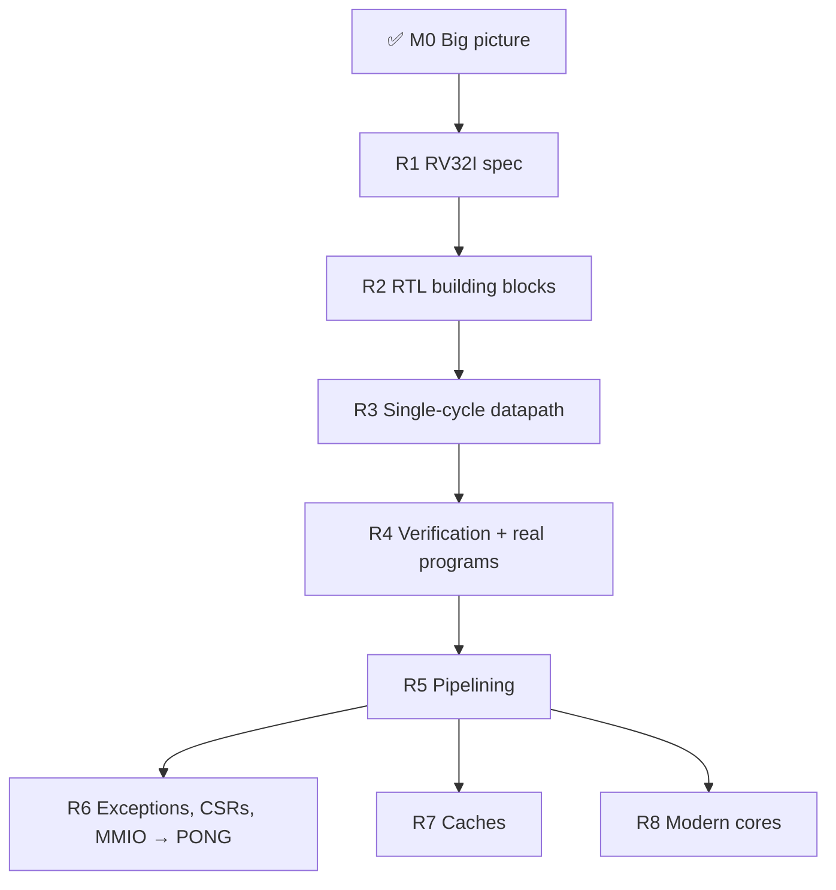

# Computer Architecture Course

**Goal**: understand how CPUs work well enough to design RISC-V cores in RTL.
**HDL**: VHDL for the project, with SystemVerilog shown next to key snippets (industry standard).
**References**: Patterson & Hennessy (RISC-V Ed.), Onur Mutlu's lectures.

| # | Module | What I'll be able to do | Book | Status |
| :--- | :--- | :--- | :--- | :--- |
| M0 | [[M0 - The Big Picture]] | State machine, ISA vs microarchitecture | Ch 1 | ✅ Done |
| R1 | [[R1 - RV32I as a Hardware Spec]] | Read any instruction's bits and know exactly what state it changes | Ch 2 (trimmed) | ⏭ Next |
| R2 | RTL Building Blocks | Know what hardware each VHDL pattern makes (comb vs seq, no latches); ALU, RegFile, Imm_Gen | App A, Ch 4.2 | |
| R3 | Single-Cycle Datapath | Derive every mux and control signal in CPU_Top | Ch 4.3–4.4 | |
| R4 | Verification + Real Programs | Self-checking testbenches, riscv-gcc → hex → IMEM, pass riscv-tests | — | |
| R5 | Pipelining | 5-stage pipeline: hazards, forwarding, stalls, flushes (+ just enough performance math) | Ch 1.6, 4.5–4.8 | |
| R6 | Exceptions, CSRs, MMIO | Traps, `ecall`, memory-mapped HDMI/buttons → PONG | Ch 4.9, 5.14 | |
| R7 | Caches | Direct-mapped cache in RTL | Ch 5.3, 5.9 | |
| R8 | Modern Cores | Branch predictors, superscalar, out-of-order | Ch 4.10 + Mutlu | |

**Optional reading**: Ch 1.2 (8 Great Ideas), Ch 1.7 (Power Wall: clocks stopped at ~4 GHz because of heat, not because transistors stopped shrinking).

