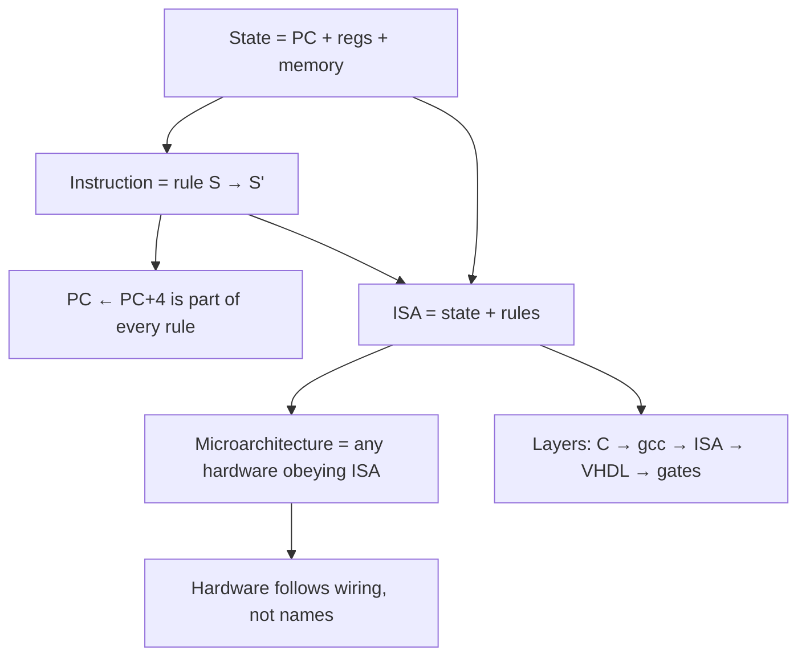

# M0 - The Big Picture

**Sources**: Patterson & Hennessy RISC-V Ed. Ch 1.1–1.4, Onur Mutlu *Fundamentals of Computer Architecture* Lecture 1 (~26:00)
**Next**: [[R1 - RV32I as a Hardware Spec]]

A computer is a **state machine**: it holds some state, and every instruction is a rule that turns the current state into the next one.

---

## 1. State + rules

**State** is exactly 3 things:
- **PC**: address of the current instruction
- **Registers**: x0–x31 (x0 is always 0)
- **Memory**: all the bytes

**ALL an instruction ever does is change the state.**

$$
S \xrightarrow{\text{instruction}} S'
$$

Analogy: chess. The board is the state, a move is an instruction.

## 2. The PC is part of every instruction

The CPU is a dumb loop: **read PC → fetch instruction at that address → do it → repeat.** It has zero memory of "where it is". The PC is the only bookmark.

So "go to the next instruction" is **not automatic**. Every normal instruction has to write PC ← PC + 4, or the CPU runs the same instruction forever.

| Instruction | Registers / memory change | PC change |
| :--- | :--- | :--- |
| `add x5, x6, x7` | x5 ← x6 + x7 | PC ← PC + 4 |
| `lw x5, 8(x10)` | x5 ← Mem[x10 + 8] | PC ← PC + 4 |
| `sw x5, 8(x10)` | Mem[x10 + 8] ← x5 | PC ← PC + 4 |
| `beq x1, x2, L` | nothing | PC ← L if equal, else PC + 4 |
| `jal x1, L` | x1 ← PC + 4 | PC ← L |

**In CPU_Top**: the PC register itself never adds anything. `u_add_pc_4` computes PC + 4, the `pc_src` mux picks the next PC, and the PC register writes it down at the clock edge.

## 3. Load vs store

The ALU can only work on registers, so data has to move between memory and registers. Registers = desk, memory = bookshelf.

| Criteria | `lw x5, 8(x10)` | `sw x5, 8(x10)` |
| :--- | :--- | :--- |
| **Direction** | Memory → register | Register → memory |
| **State change** | x5 ← Mem[x10 + 8] | Mem[x10 + 8] ← x5 |
| **x5 is** | Destination (overwritten) | Source (only read) |
| **x10 + 8 is** | Address to read | Address to write |

`x10 + 8` is **always an address**. Memory → memory isn't allowed, so copying goes through a register (`lw x7, 0(x10)` then `sw x7, 4(x10)`).

## 4. ISA vs microarchitecture

- **ISA**: the contract = **state + instructions** (encoding + exactly what each one does). Not just "a list of commands", because the commands mean nothing without the state they act on.
- **Microarchitecture**: the physical hardware that carries out the ISA correctly.

| Criteria | ISA (the recipe) | Microarchitecture (the kitchen) |
| :--- | :--- | :--- |
| **Defines** | State + instructions | Hardware that carries them out |
| **Visible to** | Programmers, compilers | Hardware designers only |
| **Examples** | x0–x31, PC, what `beq` does, encodings | Single-cycle vs pipeline, cache size, branch predictor |
| **How many per ISA** | Exactly 1 | Unlimited |
| **If changed** | Software must change too | Same results, only speed/power/cost change |
| **In this project** | `Specifications/*.md` | `CPU_Top.vhd` |

**ISA test**: can machine code name it or see its effect? Yes → ISA. No → microarchitecture.

### Same ISA, different hardware

| CPU | Stages | Pipeline registers |
| :--- | :--- | :--- |
| Our CPU_Top | 1 (single-cycle) | None |
| PicoRV32 | Not pipelined (multi-cycle) | None |
| Ibex (lowRISC) | 2 (optionally 3) | 1–2 |
| Textbook / OAK MIPS | 5 | 4 |
| SiFive U74 | 8 | 7 |

All run the same RISC-V code. **The 5-stage pipeline is just the textbook example, not part of the ISA.** If we pipeline CPU_Top later, compiled programs run unchanged.

### Pipeline registers (preview of M4b)

- **Stages**: hardware split into IF → ID → EX → MEM → WB, each working on a different instruction at the same time (assembly line).
- **Pipeline registers**: trays between stages (IF/ID, ID/EX, EX/MEM, MEM/WB) that hold one instruction's half-finished work steady for a cycle while the previous stage moves on to the next instruction.
- No instruction can name them, so they're microarchitecture.

## 5. Layers of abstraction

Each layer hides the one below it and only talks to it through a contract.

| Layer | In the PONG project |
| :--- | :--- |
| Problem | Play PONG on a screen |
| Algorithm | Move ball, check collisions, update score |
| Program | `pong.c` |
| System software | `riscv-gcc` → RV32I machine code |
| **ISA** (software/hardware line) | RV32I |
| Microarchitecture | `CPU_Top.vhd` |
| Logic | LUTs, flip-flops (Vivado synthesis) |
| Circuits | Transistors in the Zybo's FPGA |

- **Change a layer below the ISA** (e.g. pipeline CPU_Top) → nothing above notices.
- **Change the ISA** (e.g. add `mul`, RV32I → RV32IM) → hardware below must implement it **and** compiler above must know it (`-march=rv32im`).

## 6. Hardware follows wiring, not names

The CPU never sees "mul" or "ecall". It sees 32 bits and does whatever its wiring does with them.

**Example (our CPU)**: `mul` vs `add` differ only in bit 25. Our slicer only wires out bit 30 (`funct7_b5`), so ALU_Control picks `ALU_ADD`. **`mul` silently runs as `add`.**

**Example (our CPU)**: `ecall` (opcode `1110011`) hits `when others => null` in `Control.vhd` → all control signals default to 0 → nothing written, PC ← PC + 4. A do-nothing instruction.

## Project notes

- [ ] Compile C with `-march=rv32i` (no `mul`) until a multiplier is added
- [ ] Later: unknown opcodes should raise an illegal-instruction exception (Ch 4.9) instead of acting as a no-op

---

