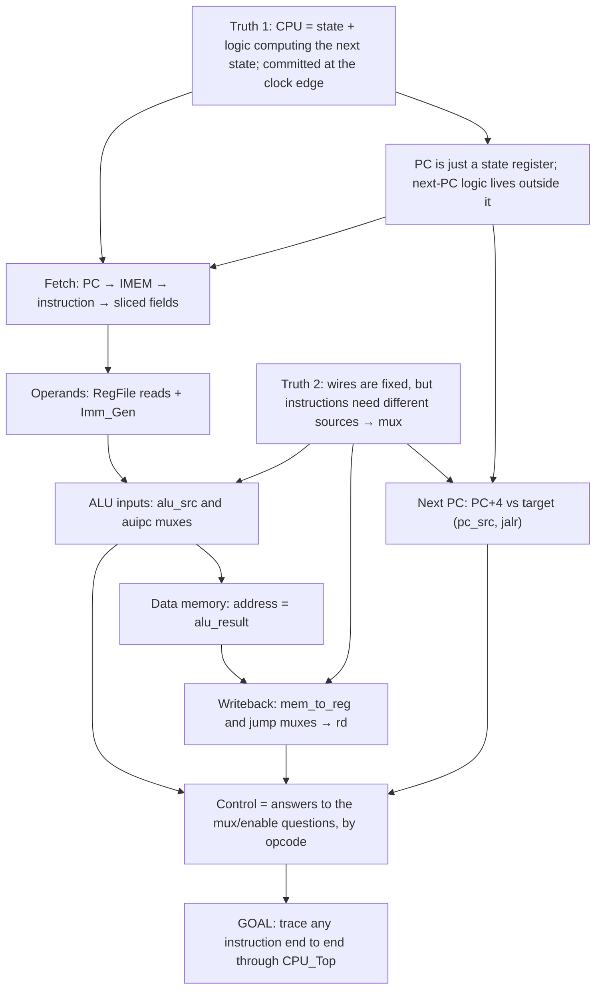
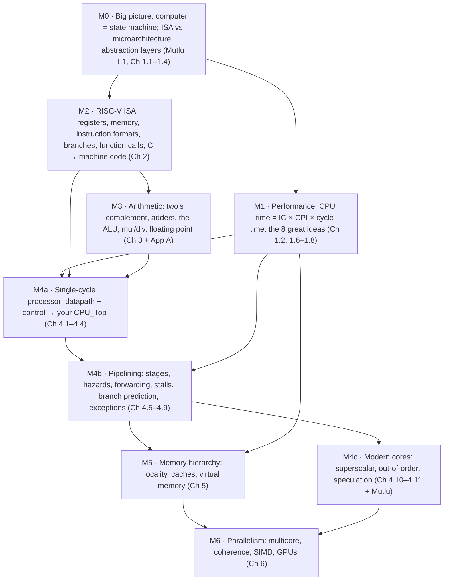
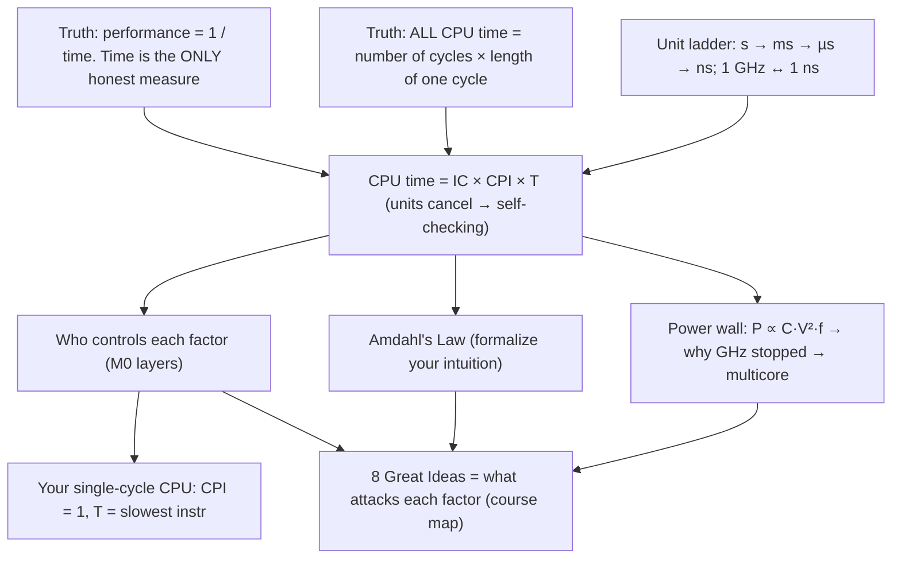
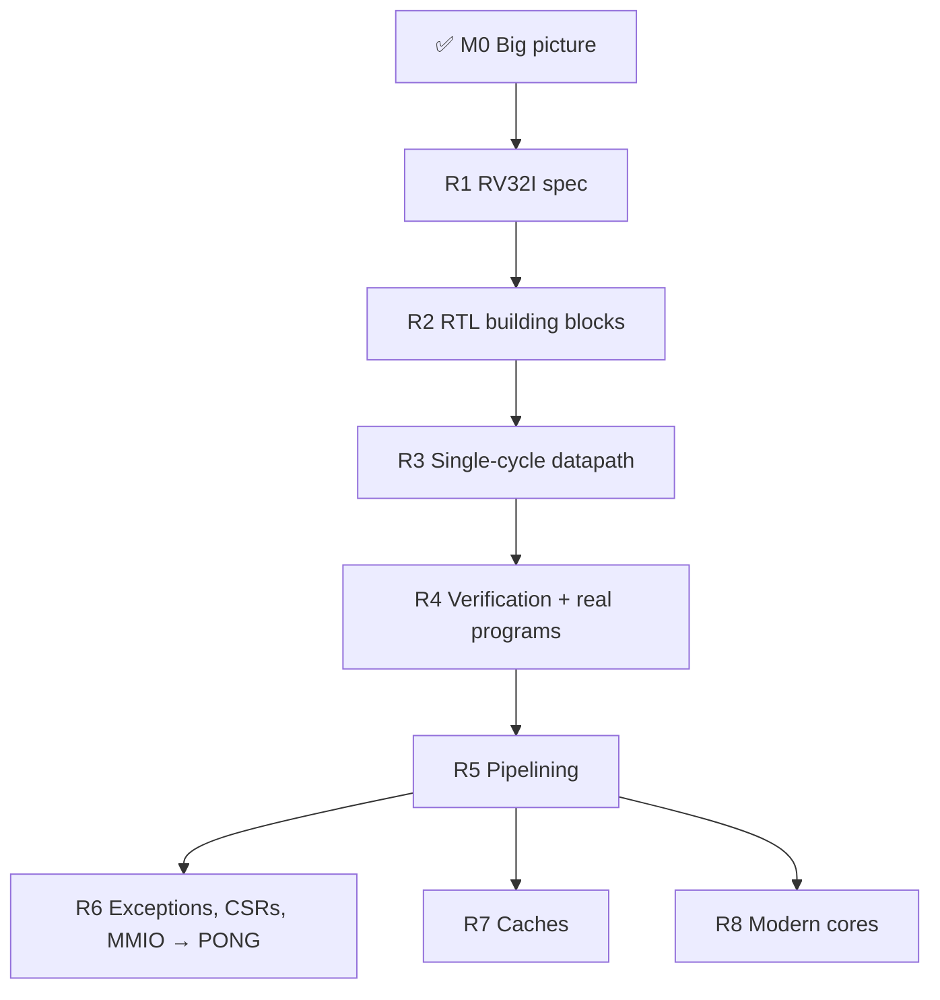
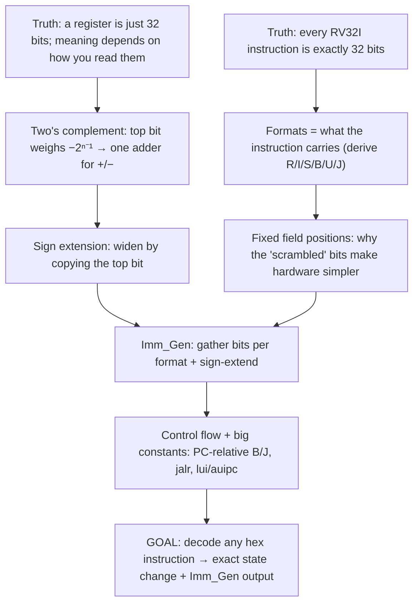

> [!quote] YOU

> [!note] SKILL loaded: teach

> [!question] Question
> What do you want to understand right now?
>
> Pick the one closest to what you want. You can also choose Other and describe it, even roughly, like "I don't get why X works."
>
> 1. How the whole datapath works end to end
> 2. Instruction formats and decoding
> 3. How the Control / ALU_Control signals are derived
> 4. Branches and jumps
> 5. Going from single-cycle to a pipeline
> 6. Path to running C / PONG

> [!example] Answer
> 1. How the whole datapath works end to end

> [!question] Quiz
> In your single-cycle CPU, which components actually change their stored value on a rising clock edge?
>
> 1. ALU
> 2. PC
> 3. Data memory (when mem_write = 1)
> 4. Control unit
> 5. Imm_Gen
> 6. Register file (when reg_write = 1)

> [!failure] Quiz — incorrect ✗
> Your answer: 3. Data memory (when mem_write = 1), 6. Register file (when reg_write = 1)
> Correct answer: 2, 3, 6
>
> Only the state elements (PC, register file, data memory) store anything, so only they update on the clock edge. The ALU, Control and Imm_Gen are combinational: their outputs are just functions of their current inputs and settle partway through the cycle. They remember nothing.

> [!abstract] PI

He separated memory from logic correctly but left out the PC. I'll probe that a bit more.

> [!question] Quiz
> In CPU_Top, the PC entity has inputs clk, rst, pc_in and an output pc_out. How does pc_out behave?
>
> 1. pc_out holds its value all cycle and copies pc_in only at the rising clock edge
> 2. The PC adds 4 to itself internally each cycle, and pc_in is only used for branches
> 3. pc_out changes whenever the instruction memory finishes reading
> 4. pc_out follows pc_in immediately, like a wire, and the clock only matters for the register file

> [!failure] Quiz — incorrect ✗
> Your answer: 2. The PC adds 4 to itself internally each cycle, and pc_in is only used for branches
> Correct answer: 1
>
> The PC is a 32-bit register (a row of flip-flops). All cycle long it holds the current instruction's address steady. Meanwhile the separate Adder computes pc_out + 4 combinationally, and the PCSrc mux picks pc_in. Only at the next rising edge does the PC copy pc_in into pc_out. That edge is what moves the CPU to the next instruction. If the PC weren't clocked, pc_out → +4 → pc_in → pc_out would be a combinational loop that races forever.

> [!question] Quiz
> Your CPU is single-cycle. For one `add x5, x6, x7`, when do the fetch, the ALU addition and the write into x5 happen?
>
> 1. Fetch and ALU in cycle 1, write back to the register in cycle 2
> 2. Fetch, ALU and the register write all happen at the same instant the clock edge rises
> 3. Fetch, ALU and the register write all finish in one cycle, with the write at its closing edge
> 4. Fetch in cycle 1, ALU in cycle 2, write back to the register in cycle 3

> [!success] Quiz — correct ✓
> Your answer: 3. Fetch, ALU and the register write all finish in one cycle, with the write at its closing edge
> Correct answer: 3
>
> In a single-cycle design everything between the state elements is one big combinational cloud. After a clock edge, new values leave the PC/registers, ripple through IMEM → Control/RegFile/ImmGen → ALU → DMEM → muxes, and all of it settles inside the same cycle. The next edge captures the settled results into the PC, register file and data memory at the same moment. So the add happens in cycle N and its result is written at the edge that ends cycle N.

> [!abstract] PI

The timing model is solid. Now the data-routing strand.

> [!question] Quiz
> For `lw x5, 8(x10)`, what reaches the ALU inputs in your CPU_Top?
>
> 1. ALU is unused, imm_out (8) goes straight to the memory address port
> 2. ALU in_1 = read_data_1 (x10), ALU in_2 = imm_out (8), alu_result = memory address
> 3. ALU in_1 = read_data_1 (x10), ALU in_2 = read_data_2 (x5), alu_result = memory address
> 4. ALU in_1 = pc_out, ALU in_2 = imm_out (8), alu_result = memory address

> [!question] Quiz — I don't know
> Your answer: I don't know
> Correct answer: 2
>
> A load address is base register plus offset. The base x10 comes out of the register file as read_data_1 and goes to ALU input 1 (auipc = 0). The offset 8 is in the instruction, so Imm_Gen extracts and sign-extends it, and alu_src = 1 makes the mux pass imm_out to ALU input 2. The ALU adds them, and alu_result goes to Data_Memory's address port.

> [!abstract] PI

That's the edge for routing. Now I need the floor below it: is the problem the hardware wiring, or what `lw` itself means?

> [!question] Quiz
> What does `lw x5, 8(x10)` do as an instruction, ignoring hardware?
>
> 1. x5 ← Memory[x10 + 8]
> 2. Memory[x10 + 8] ← x5
> 3. x5 ← x10 + 8
> 4. x5 ← Memory[x10] + 8

> [!question] Quiz
> Your Mux2 entity has in_0, in_1, sel and mux_out. What does it do?
>
> 1. Outputs in_0 + in_1 when sel = 1, otherwise outputs in_0
> 2. Stores in_1 into in_0 on the clock edge when sel = 1
> 3. Outputs in_0 when sel = 0 and in_1 when sel = 1
> 4. Outputs in_0 AND in_1 bitwise, with sel enabling the output

> [!success] Quiz — correct ✓
> Your answer: 1. x5 ← Memory[x10 + 8]
> Correct answer: 1
>
> Note: So from what I know lw is load word, where its function is to load a word from memory into a regsiter such as x5
>
> `lw rd, offset(rs1)` means: compute the address rs1 + offset, read the 32-bit word at that memory address, and put it in rd. So x5 ← Mem[x10 + 8]. The 8 is a byte offset added to the address in x10. It is never added to the loaded data.

> [!success] Quiz — correct ✓
> Your answer: 3. Outputs in_0 when sel = 0 and in_1 when sel = 1
> Correct answer: 3
>
> A 2-to-1 mux is a pure selector. It outputs in_0 when sel = 0 and in_1 when sel = 1. It never computes anything. Control signals like alu_src, mem_to_reg and pc_src are mostly just the sel lines of these muxes, which is how one fixed set of wires serves every instruction type.

> [!abstract] PI

You know what `lw` does and you know what a mux does. The gap is connecting the two in hardware. One last strand: how instruction bits become register reads.

> [!question] Quiz
> For `lw x5, 8(x10)`, how does the register file end up outputting the contents of x10 on read_data_1?
>
> 1. Instruction bits 19:15 hold 10 and are wired straight to read_reg_1, which reads x10 combinationally
> 2. Instruction bits 19:15 hold 10, but x10 only reaches read_data_1 after the next clock edge
> 3. The Control unit decodes the opcode and outputs the register number 10 to read_reg_1
> 4. The register file outputs all 32 registers and the ALU picks x10 using funct3

> [!success] Quiz — correct ✓
> Your answer: 1. Instruction bits 19:15 hold 10 and are wired straight to read_reg_1, which reads x10 combinationally
> Correct answer: 1
>
> The instruction itself carries the register numbers in fixed bit positions. The rs1 field (bits 19:15) holds 01010 = 10. The Instruction_Slicer just wires those bits to read_reg_1, and the register file reads combinationally, so read_data_1 shows x10's contents within the same cycle without waiting for a clock. Control never decides register numbers. It only looks at the opcode.

> [!abstract] PI

Last check: does the routing work in the simplest case, R-type?

> [!question] Quiz
> For `add x5, x6, x7`, what is alu_src and what reaches ALU input 2?
>
> 1. alu_src = 0, ALU in_2 = read_data_2 (x7)
> 2. alu_src = 1, ALU in_2 = read_data_2 (x7)
> 3. alu_src = 0, ALU in_2 = pc_out
> 4. alu_src = 1, ALU in_2 = imm_out

> [!success] Quiz — correct ✓
> Your answer: 1. alu_src = 0, ALU in_2 = read_data_2 (x7)
> Correct answer: 1
>
> Note: ALU input 2 would be inputting the second "data source" which is x7 but for alu_src I think it would just be the fault no? which is 0
>
> For `add x5, x6, x7` both operands are registers: rs1 = x6 → read_data_1 and rs2 = x7 → read_data_2. Control sets alu_src = 0, so the ALUSrc mux passes read_data_2, not imm_out, to ALU input 2. The sum leaves as alu_result, mem_to_reg = 0 picks it over memory data, and it's written into x5 (rd, bits 11:7) at the clock edge.

> [!abstract] PI

I've found where your understanding stops, so here's what I learned and the plan.

## What I found

| Strand | Where you are |
|---|---|
| What instructions *mean* (`lw` → `x5 ← Mem[x10+8]`) | ✅ Solid |
| What a mux does | ✅ Solid |
| Single-cycle timing (logic settles during the cycle, the write happens at the closing edge) | ✅ Solid |
| How instruction bits pick registers (bits 19:15 → `read_reg_1`) | ✅ Solid |
| **The PC** | ❌ You picture it as a counter that adds 4 to itself. It's actually a plain register; the +4 and the branch choice are done by logic outside it |
| **Why each mux exists / what each control signal decides** | ❌ This is where it stops. You got R-type right by reasoning "0 is the default", couldn't place `lw`'s operands, and the parts after the ALU are unknown |

So you have the meaning of instructions and the parts, but not the reason the wiring looks the way it does. Every mux in `CPU_Top` looks arbitrary right now, and that's the thing to fix.

## The approach

I'll start from one unconditional truth: **a CPU is nothing but state (PC, registers, memory) plus logic that computes the next state, and that state is committed at each clock edge.** Fixing that first also fixes the PC misconception, because the PC turns out to be just one more piece of state.

Then a second truth: **wires are fixed, but different instructions need different values in the same place.** From that you can derive every mux yourself. Each control signal then stops being a lookup-table entry and becomes the answer to a question like "where does ALU input 2 come from for this instruction?"

After that we walk the datapath left to right (fetch → operands → ALU → memory → writeback → next PC). At each stage you'll work out what's needed before I show you the line in `CPU_Top.vhd`. We finish by tracing `add`, `lw`, `sw`, `beq` and `jal` through your code. Mostly Socratic, since you can clearly reason your way there.

## Dependency map

Does this plan work for you, or do you want to change the scope (for example, skip branches for now, or go deeper on something)?

> [!quote] YOU

I really just wanna learn about RIS V and Computer Architecture from @Documentation/Research/Computer-Organization-and-Design-The-Hardware-Software-Interface-RISC-V-Edition.pdf and these kinds of youtube videos https://www.youtube.com/watch?v=uKgMFj1eQQc&t=1564s so please do teach me all about those

> [!question] Question
> How should I order the whole course?
>
> All options cover the full book + Mutlu-style material eventually. The difference is the route and what you get first.
>
> 1. Foundations-first, project-linked (Recommended)
> 2. Strict book order, theory only
> 3. Mutlu course order
> 4. Project-driven

> [!example] Answer
> 1. Foundations-first, project-linked (Recommended)

> [!abstract] PI

Good. Here's the full roadmap.

## The approach

The whole field rests on one idea, which both Mutlu (Lecture 1) and the book open with:

> **A computer is a state machine.** Its state is the PC, the registers and memory. Every instruction is a rule that turns state $S$ into the next state $S'$. The **ISA** is the contract that says what those rules are. The **microarchitecture** is the hardware that carries them out.

Everything else answers one of two questions: *what are the rules?* (ISA, Ch 2–3) or *how do we carry them out fast?* (Ch 4–6). The performance equation tells you what "fast" means, which is why it comes before any hardware. Without it, pipelining and caches look like random tricks instead of obvious moves.

Each module starts with a short probe like the one you just did, because I've only mapped your Ch 2 and Ch 4 knowledge so far. Each hardware module ends tied to your own VHDL, so you understand `CPU_Top` while you study the theory.

## Course map

## What comes first: M0, the big picture

1. **The state machine view.** State = PC + 32 registers + memory. This also fixes the PC misconception from your probe: the PC is just one piece of state, not a counter.
2. **ISA vs microarchitecture.** One contract, many possible hardware designs. Your single-cycle CPU and an Intel core can both run the same program if they share the ISA.
3. **The abstraction layers.** Problem → algorithm → C → assembly → machine code → microarchitecture → logic → transistors. This shows where every later module sits.

Then M1 (performance) and M2 (the RISC-V ISA, which also gets you toward compiling C for your CPU).

Does this roadmap work, or should something change before I start M0?

> [!quote] YOU

Can you make sure to explain it like how I would using my writing style ig

> [!question] Quiz
> Your single-cycle VHDL CPU and a commercial pipelined RISC-V chip (e.g. SiFive) can both run the same RV32I machine code. How are they related?
>
> 1. Different ISA and different microarchitecture
> 2. Same ISA, different microarchitecture
> 3. Different ISA, same microarchitecture
> 4. Both are RISC-V, so they must have the same ISA and the same microarchitecture

> [!success] Quiz — correct ✓
> Your answer: 2. Same ISA, different microarchitecture
> Correct answer: 2
>
> The ISA is the **contract**: which instructions exist, which registers there are, and what each instruction does to the state. The microarchitecture is **how a specific chip carries out that contract** (single-cycle, pipelined, out-of-order, cache sizes...). Analogy: the ISA is a car's pedals and steering wheel, and the microarchitecture is the engine under the hood. Every car has the same pedals even though the engines are completely different. Since your CPU and a SiFive chip both implement RV32I, they can run the same machine code with completely different hardware.

> [!abstract] PI

Correct. Let's make it harder.

> [!question] Quiz
> Which of these are part of the RISC-V ISA (the contract), not the microarchitecture?
>
> 1. The data cache is 32 KB
> 2. The bit positions of the immediate inside an I-type instruction
> 3. There are 32 integer registers and x0 always reads as 0
> 4. `beq` jumps to PC + offset when rs1 equals rs2
> 5. The CPU uses a 5-stage pipeline
> 6. The CPU has a branch predictor

> [!failure] Quiz — incorrect ✗
> Your answer: 2. The bit positions of the immediate inside an I-type instruction, 4. `beq` jumps to PC + offset when rs1 equals rs2
> Correct answer: 2, 3, 4
>
> Note: In general it's usually more about the ig available commands that you could do and how to funnel them in such a way that they successfully execute
>
> The quick test: **would a programmer's machine code break or behave differently if this changed?** If yes, it's part of the ISA.
> - **32 registers, x0 = 0**: ISA. The code literally names x0–x31.
> - **What `beq` does**: ISA. That's the meaning of the instruction.
> - **The immediate bits in the encoding**: ISA. The machine code depends on that exact layout.
> - **Pipeline stages, cache size, branch predictor**: microarchitecture. They change *speed*, not *results*. The same program gives the same output whether it runs on 1 stage or 5, with or without a cache.

> [!abstract] PI

Interesting. Your note says the ISA is "the available commands", so you're thinking of the ISA as just a list of instructions. Let me check how far that goes.

> [!question] Quiz
> Is the existence of the PC (program counter) part of the ISA or the microarchitecture?
>
> 1. ISA, since instructions like beq and jal are defined by what they do to the PC
> 2. Microarchitecture, since the PC is a hardware register that the designer builds
> 3. Neither, since the PC is hidden and programs never interact with it
> 4. Microarchitecture, since single-cycle and pipelined CPUs update the PC differently

> [!failure] Quiz — incorrect ✗
> Your answer: 2. Microarchitecture, since the PC is a hardware register that the designer builds
> Correct answer: 1
>
> The PC is part of the ISA. The contract has to define it, because instructions like `beq`, `jal` and `auipc` are defined *in terms of* the PC (e.g. "`beq`: if rs1 == rs2 then **PC ← PC + offset**"). You can't define what an instruction does without defining the thing it changes. How the PC is *built* (a register, an adder, a mux) is microarchitecture, but the fact that a PC exists and what instructions do to it is ISA.

> [!question] Quiz
> Using the state machine view (state = PC + registers + memory), what does `add x5, x6, x7` change?
>
> 1. x5 changes to x6 + x7, and x6 and x7 are cleared after use
> 2. Only x5 changes, to x6 + x7
> 3. x5 changes to x6 + x7, and the result is also saved to memory
> 4. x5 changes to x6 + x7, and PC changes to PC + 4

> [!failure] Quiz — incorrect ✗
> Your answer: 2. Only x5 changes, to x6 + x7
> Correct answer: 4
>
> Two pieces of state change: **x5 ← x6 + x7** and **PC ← PC + 4**. Every instruction changes the PC. "Go to the next instruction" is itself a state change, and the ISA spells it out as part of what `add` means. That's why the PC belongs to the ISA: without it, "what happens next" wouldn't be defined. x6 and x7 are only *read*, not changed, and memory isn't touched.

> [!abstract] PI

This is the exact spot to fix, so I'll come at it from a different angle. Try discovering it yourself:

> [!question] Quiz
> The PC is 0x100 and `add x5, x6, x7` sits at address 0x100. The CPU always fetches the instruction at the address in the PC. Suppose `add` really did change only x5. What happens next?
>
> 1. It moves on to 0x104 anyway, because the CPU naturally goes to the next instruction
> 2. It jumps back to address 0, because the PC resets when it isn't updated
> 3. It fetches the add at 0x100 again, forever, because the PC still says 0x100
> 4. It stops, because there is no next instruction defined

> [!failure] Quiz — incorrect ✗
> Your answer: 1. It moves on to 0x104 anyway, because the CPU naturally goes to the next instruction
> Correct answer: 3
>
> If `add` only changed x5, the PC would still hold 0x100 afterwards. The CPU fetches whatever the PC points at, so it would fetch the **same `add` again**, forever. The program would never reach 0x104. So "move to the next instruction" isn't automatic or free. It's a real change to the state, PC ← PC + 4, and every non-jump instruction has to do it as part of its meaning.

> [!question] Quiz
> A buggy CPU implements every instruction correctly EXCEPT it never updates the PC (it skips the PC ← ... part of every instruction). The PC starts at 0x000. What happens?
>
> 1. It runs normally, because the CPU still steps through instructions in order
> 2. It crashes immediately, because the PC becomes undefined
> 3. It runs the instruction at 0x000 over and over forever
> 4. It runs normally until it hits the first branch or jump, then gets stuck

> [!success] Quiz — correct ✓
> Your answer: 3. It runs the instruction at 0x000 over and over forever
> Correct answer: 3
>
> The PC is the CPU's only record of where it is, and nothing updates it except what the instructions specify. With every instruction's PC update removed, the PC stays at 0x000. The CPU fetches the instruction at 0x000, executes it, fetches 0x000 again, and so on forever. Registers still change (the first instruction keeps running), but the program never moves forward. Moving forward = writing PC + 4 into the PC, every single instruction.

> [!abstract] PI

It clicked. One more transfer check in the original format to confirm:

> [!question] Quiz
> What state does `sw x5, 8(x10)` change?
>
> 1. Mem[x10 + 8] ← x5, and nothing else changes
> 2. Mem[x10 + 8] ← x5, and x5 is cleared to 0
> 3. x5 ← Mem[x10 + 8], and PC ← PC + 4
> 4. Mem[x10 + 8] ← x5, and PC ← PC + 4

> [!failure] Quiz — incorrect ✗
> Your answer: 3. x5 ← Mem[x10 + 8], and PC ← PC + 4
> Correct answer: 4
>
> Note: Store word to x5 based on the memory address of x10 + 8
>
> `sw` writes a register's value *into memory*: Mem[x10 + 8] ← x5. And like every non-jump instruction, it also moves the bookmark: PC ← PC + 4. x5 and x10 are only read, and no register changes. So: memory changes, the PC changes, the registers stay the same.

> [!question] Quiz
> What is the net effect of running these two instructions in order?
>
> lw x7, 0(x10)
> sw x7, 4(x10)
>
> 1. x7 ends up holding a copy of Mem[x10 + 4]
> 2. Mem[x10 + 4] ends up holding a copy of Mem[x10]
> 3. Mem[x10 + 4] ends up holding the original value of x7
> 4. Mem[x10] ends up holding a copy of Mem[x10 + 4]

> [!success] Quiz — correct ✓
> Your answer: 2. Mem[x10 + 4] ends up holding a copy of Mem[x10]
> Correct answer: 2
>
> This copies a value from one memory spot to another, but memory→memory isn't allowed, so it has to go through a register. `lw x7, 0(x10)` brings Mem[x10] onto the desk (x7 ← Mem[x10 + 0]). Then `sw x7, 4(x10)` puts it back on the shelf at a new spot (Mem[x10 + 4] ← x7). x7 is the destination in the load and the source in the store. Both instructions also do PC ← PC + 4.

> [!question] Quiz
> Later you'll add pipeline registers (e.g. IF/ID) to your CPU. Compare register x10 with an IF/ID pipeline register. Which is part of the ISA?
>
> 1. Both are microarchitecture, since both are flip-flops the designer builds
> 2. Both are ISA, since both hold values that affect what the program computes
> 3. x10 is ISA and the pipeline register is microarchitecture, since only x10 can be named by instructions
> 4. x10 is microarchitecture and the pipeline register is ISA, since pipeline stages are in the spec

> [!failure] Quiz — incorrect ✗
> Your answer: 2. Both are ISA, since both hold values that affect what the program computes
> Correct answer: 3
>
> Note: From what I know x10 is a certain register and IF/ID is basically what the core will do to execute an instruction, and I think both are ISA's since I don't see x10 being referenced in MIPS or any of my OAK lectures (they mostly reference specific registers, while IF/ID is also part of the ISA since it's fetch, decide, execute, store/writeback in MIPS I think anw
>
> A pipeline register (like IF/ID) is extra internal storage that no instruction can name, read or write. So it's pure microarchitecture: invisible to programs, there only to make the hardware faster. x10, by contrast, is ISA state. Machine code names it directly (the rs1 field = 01010), and the ISA defines what instructions do to it. Both are flip-flops in hardware, but whether something is ISA or microarchitecture depends on whether the contract defines it, not on what it's built from.

> [!question] Quiz
> Your current CPU_Top is single-cycle: it has NO IF/ID register. Can it run RV32I programs correctly, and what does that tell you?
>
> 1. It can run them, but only programs without branches
> 2. It can't run them correctly, since without IF/ID it breaks the ISA
> 3. It can run them correctly, which shows IF/ID isn't required by the ISA
> 4. It can run them correctly, because Vivado adds the IF/ID register automatically

> [!question] Quiz — I don't know
> Your answer: I don't know
> Correct answer: 3
>
> Note: I thought IF/ID were pipelines not registers or do they have specific architecutre I don;t really know honestly
>
> Your single-cycle CPU has **no** IF/ID register (look at `CPU_Top.vhd`: no pipeline registers anywhere), yet it can run RV32I programs and get correct results. A pipelined RISC-V chip has IF/ID and gets the **same** results. If IF/ID were part of the contract, your CPU would be breaking the contract, but it runs the same programs just fine. So IF/ID can't be in the contract. It's a design choice for speed, which makes it microarchitecture. (Fetch → decode → execute as *ideas* still happen in every CPU, since that's the dumb loop from Node 1. But splitting them into separate hardware stages with registers in between is a microarchitecture choice.)

> [!abstract] PI

That's a fair gap. You haven't been taught the pipeline yet (that's M4b), so I used a term too early. Here's the minimum needed to settle the ISA question; the details wait for M4b.

### Steps vs stages vs pipeline registers

**Steps:** every instruction goes through the same jobs: fetch it, decode it, execute it, access memory, write back. These are just the *jobs*, and every CPU does them, since this is Node 1's loop.

**How your CPU does them:** all 5 jobs happen inside **one** clock cycle, one instruction at a time. No splitting.

**How a pipelined CPU does them:** an assembly line. The hardware is cut into 5 **stages** (IF, ID, EX, MEM, WB), and each stage works on a *different* instruction at the same moment, like 5 workers on a car factory line.

The catch: when the clock ticks, each worker has to hand their half-finished work to the next worker. So between every pair of stations there's a **tray** that holds the half-finished stuff. Those trays are the **pipeline registers**, named after the two stages they sit between:

So **IF/ID = the tray between fetch and decode.** It holds the just-fetched instruction so the decode stage can work on it next cycle, while fetch has already moved on to the next one.

| Criteria | Your single-cycle CPU | Pipelined CPU |
| :--- | :--- | :--- |
| **Steps done** | Fetch, decode, execute, mem, writeback | Same 5 steps |
| **How** | All 5 in one cycle, 1 instruction at a time | 5 stages, 5 instructions in flight at once |
| **Pipeline registers (trays)** | None | IF/ID, ID/EX, EX/MEM, MEM/WB |
| **Program results** | Identical | Identical |
| **Speed** | Slower | Faster |

The bottom two rows answer the ISA question: same results means the trays are invisible to the program, so they're microarchitecture.

> [!question] Quiz
> Now that IF/ID is just "the tray between fetch and decode": which is part of the ISA?
>
> 1. x10 is microarchitecture and IF/ID is ISA, since the stage names come from the spec
> 2. Both ISA, since every RISC-V CPU must have the 5 pipeline stages
> 3. Both microarchitecture, since both are just flip-flops in hardware
> 4. x10 is ISA and IF/ID is microarchitecture, since no instruction can name IF/ID

> [!failure] Quiz — incorrect ✗
> Your answer: 2. Both ISA, since every RISC-V CPU must have the 5 pipeline stages
> Correct answer: 4
>
> Note: Oh so essentially those aren't stages but basically a place or register to place the half baked work done as to feed it to the next stage, but why do they do that
>
> Ask the ISA test from earlier: does any instruction name or read the IF/ID register? No. There's no `read IF/ID` instruction, and machine code can only name x0–x31 (plus memory and, indirectly, the PC). The single-cycle CPU has no trays and still gives identical results, so the trays aren't required by the contract. They exist only to make the hardware faster, which makes them microarchitecture. x10 is named directly in machine code, so it's ISA.

> [!question] Quiz
> Ibex has 2 stages; your CPU_Top has 1. Both implement RV32I. Which is true?
>
> 1. Different ISA, since Ibex has 2 stages and the ISA requires 5, so it's not true RISC-V
> 2. Different ISA, since its pipeline registers add extra state that programs see
> 3. Same ISA, different microarchitecture, so the same machine code runs on both
> 4. Same microarchitecture, since both implement RV32I, so they have the same stages

> [!failure] Quiz — incorrect ✗
> Your answer: 4. Same microarchitecture, since both implement RV32I, so they have the same stages
> Correct answer: 3
>
> Ibex has a different microarchitecture (2 stages, different trays, different internals) but the same ISA (same state: x0–x31, PC, memory; same rules: what every RV32I instruction does). The contract is what programs depend on, so the same machine code runs correctly on both. Ibex's 2-stage design is only a different way of following the same rules. Its speed differs from yours, but its results don't.

> [!question] Question
> In your own words: what does "ISA" mean to you right now, and what does "microarchitecture" mean to you right now?
>
> No grading, just rough and honest. One or two sentences each is fine, Indo/English mix is fine. If you're tired and want to pause here, say that instead, totally fine.

> [!example] Answer
> ISA or Insuction Set Architecture is a set of instructions that could be used to build increasingly complex instructions, while microarchitecture is more like the physical hardware that enables the ISA to be executed correctly

> [!question] Quiz
> Say you've compiled a C program to RV32I machine code and it runs correctly on your single-cycle CPU_Top. Next semester you redesign CPU_Top into a 5-stage pipeline (correctly). Do you need to recompile the C program?
>
> 1. No recompile, but the program now gives different results because of the pipeline
> 2. Yes, recompile, because adding pipeline registers changes the ISA
> 3. Yes, recompile, because the compiler targets your specific pipeline stages
> 4. No, the same compiled program runs unchanged, because the ISA didn't change

> [!success] Quiz — correct ✓
> Your answer: 4. No, the same compiled program runs unchanged, because the ISA didn't change
> Correct answer: 4
>
> The compiled program is just a sequence of RV32I instructions, written against the **ISA** (state + rules). Turning your CPU into a pipeline changes only the **microarchitecture** (the kitchen), while the contract stays exactly the same. So the same `.bin` runs unchanged and gives the same results, just faster. This is the whole point of the ISA/microarchitecture split: hardware designers can keep improving the kitchen without software people having to redo anything.

> [!abstract] PI

That one landed cleanly. **Node 2 is locked in:**

> ISA = state + rules (the contract, exactly one per ISA). Microarchitecture = the hardware that follows it (many possible designs). Changing the hardware doesn't touch the contract.

---

## Node 3: The layers of abstraction (the big map)

**Why we need this:** your goal is PONG on your CPU. Between "PONG" and "electrons in the FPGA" there's a huge gap. Nobody can think about transistors while writing game logic, so the gap gets split into **layers**. Each layer only has to understand the one right below it, through a contract. Node 2's ISA is one of those contracts, and it's the most important one.

This is the main idea of Mutlu's Lecture 1 (he calls it "levels of transformation") and Ch 1.3 of the book. Here it is with your project filled in:

| Layer | What it is | In your PONG project |
| :--- | :--- | :--- |
| **Problem** | What you want done | "Play PONG on a screen" |
| **Algorithm** | Step-by-step method | Move ball, check collisions, update score |
| **Program** | Code in a language | `pong.c` |
| **System software** | Compiler, assembler, (OS) | `riscv-gcc` turns C → RV32I machine code |
| **ISA** ⬅ the contract | State + instructions | RV32I |
| **Microarchitecture** | Hardware design | `CPU_Top.vhd` (single-cycle) |
| **Logic** | Gates, flip-flops, muxes | What Vivado synthesizes: LUTs, FFs |
| **Circuits / devices** | Transistors | Inside the Zybo's FPGA chip |

**The key move:** each layer *hides* the one below it. The C programmer doesn't care if the CPU is single-cycle or pipelined. Your VHDL doesn't care how a LUT is built from transistors. That hiding is what makes it possible to build anything at all. Analogy: you drive a car with the pedals, not by thinking about fuel injection.

**Connection to Node 2:** the ISA sits exactly where **software ends and hardware begins**. Everything above it (C, gcc) only knows the contract. Everything below it (your VHDL) only has to obey the contract. That's why the Node 2 quiz worked out: redesigning a layer *below* the ISA can't affect anything *above* it.

> [!question] Quiz
> You want to add a hardware `mul` instruction (RV32I → RV32IM) so PONG's math runs faster. Which layers have to change?
>
> 1. Only the compiler, since the hardware can already multiply by repeated adding
> 2. Nothing changes, since multiply is a microarchitecture detail hidden from software
> 3. The ISA changes, so both the hardware below and the compiler above must change
> 4. Only the microarchitecture, since the ISA already allows any math operation

> [!success] Quiz — correct ✓
> Your answer: 3. The ISA changes, so both the hardware below and the compiler above must change
> Correct answer: 3
>
> Note: Since mul is an instruction then I would assume the thing that changes is the ISA, we aren't adding any new hardware
>
> Adding a multiply instruction changes the **ISA** (the menu of rules gets a new item: RV32I → RV32IM). That ripples in **both directions**. Below: your microarchitecture (`CPU_Top`) has to be upgraded to actually do multiplication, or it breaks the new contract. Above: the compiler (system software) has to be told it may emit `mul`, which is why gcc takes `-march=rv32im` vs `-march=rv32i`. Changing a layer below the ISA (Node 2's pipeline) affects nothing above. Changing the ISA itself affects both sides, because both sides depend on it.

> [!abstract] PI

Right answer, but your note has a catch: "we aren't adding any new hardware." I'll test that against your own code.

> [!question] Quiz
> Your current CPU_Top receives `mul x5, x6, x7`. What does it actually do?
>
> 1. It does nothing, because Control rejects the unknown funct7
> 2. It multiplies correctly, since mul is in the same OP_REG group as add
> 3. It silently computes x6 + x7 instead, because it only checks bit 30, which is 0
> 4. It computes x6 − x7, because funct7 isn't all zeros

> [!failure] Quiz — incorrect ✗
> Your answer: 2. It multiplies correctly, since mul is in the same OP_REG group as add
> Correct answer: 3
>
> Note: Mul meaning multiply
>
> Your hardware only checks instruction bit 30 (funct7 bit 5). For `mul`, funct7 = 0000001, so bit 30 is **0**. The bit that says "multiply" is bit 25, and your slicer never even wires it out. So Control sees OP_REG, ALU_Control sees funct3 = 000 with funct7_b5 = 0, and picks **ALU_ADD**. Your CPU silently computes x5 ← x6 + x7. No error, just a wrong answer. That's why changing the ISA forces new hardware: the contract now says "`mul` multiplies", and your current microarchitecture breaks that contract until you add a multiplier and decode bit 25.

> [!question] Quiz
> `ecall` (opcode 1110011) is a real RV32I instruction that should hand control to the operating system. Your Control.vhd has no case for opcode 1110011 (it hits `when others => null`, so every control signal stays at its default of 0). What does your CPU actually do when it fetches an ecall?
>
> 1. It freezes, since the CPU stops on an unknown opcode
> 2. Nothing is written and PC ← PC + 4, since every control signal stays at its default
> 3. It writes garbage into a register, since rd is still decoded
> 4. It performs the system call, since ecall is a standard RV32I instruction

> [!success] Quiz — correct ✓
> Your answer: 2. Nothing is written and PC ← PC + 4, since every control signal stays at its default
> Correct answer: 2
>
> Note: I forgot most of the things that I wrote so since it goes to others I would assume it just does nothing and the PC incre,ents up
>
> The opcode `1110011` isn't one of the cases in your `Control.vhd`, so it falls into `when others => null`, and every control signal keeps its default: reg_write = 0, mem_write = 0, branch = 0, jump = 0. No register or memory gets written. But the PC still updates, because pc_src = 0 makes the mux pick pc_plus_4. So your CPU treats `ecall` as "do nothing, move on". It's wrong according to the ISA (ecall should trap to the OS), but it's exactly what your wiring says. The name "ecall" is irrelevant to the hardware.

> [!question] Question
> What next?
>
> 1. Continue to M1 now
> 2. Pause here
> 3. Save M0 as an Obsidian note first

> [!example] Answer
> 3. Save M0 as an Obsidian note first

> [!abstract] PI

I saved M0 as two Obsidian notes in your writing style:

- **`Documentation/Learning/M0 - The Big Picture.md`**: the full module.
  - The state machine idea and why every instruction has to update the PC.
  - Load vs store.
  - ISA vs microarchitecture, with the 5 real RISC-V CPUs that all have different stage counts.
  - A short preview of pipeline registers.
  - The abstraction layers, using PONG as the example.
  - "Hardware follows wiring, not names", using the `mul` and `ecall` behaviour of your own CPU.
  - A checklist with two project to-dos.
- **`Documentation/Learning/Course Index.md`**: the roadmap table (M0 marked ✅) and the module map.

M1 is linked from both notes but doesn't exist yet. Obsidian will create the note when we start it.

Do you want to start M1 (Performance) now or later?

> [!quote] YOU

Let's continue right now

> [!abstract] PI

Starting **M1: Performance**. Same as before, a quick probe first so I know where to start. Pick "I don't know" whenever it's true.

> [!question] Quiz
> The Zybo Z7's main clock is 125 MHz, but say you run your CPU at 100 MHz. How long is one clock cycle?
>
> 1. 1 ns
> 2. 10 ns
> 3. 100 ns
> 4. 0.1 ns

> [!failure] Quiz — incorrect ✗
> Your answer: 3. 100 ns
> Correct answer: 2
>
> Note: 1 MHz is 1 million cycles in a second, so it's currently running 100 million meaning 1/(100 * 10^6) so 100 ns?
>
> Clock period and frequency are reciprocals: $T = 1/f$. So $1/(100 \times 10^6\ \text{Hz}) = 10 \times 10^{-9}\ \text{s} = 10\ \text{ns}$. The clock ticks 100 million times per second, so each tick lasts one hundred-millionth of a second.

> [!question] Quiz
> What is the clock period at 250 MHz?
>
> 1. 0.4 ns
> 2. 2.5 ns
> 3. 4 ns
> 4. 40 ns

> [!failure] Quiz — incorrect ✗
> Your answer: 2. 2.5 ns
> Correct answer: 3
>
> $T = 1/f = 1/(250 \times 10^6) = 4 \times 10^{-9}\ \text{s} = 4\ \text{ns}$. A quick shortcut: $1\ \text{GHz} \leftrightarrow 1\ \text{ns}$. 250 MHz is a quarter of 1 GHz, so the period is 4× longer than 1 ns.

> [!abstract] PI

Two misses in a row, so I need to check whether it's the arithmetic or the concept underneath. Here's one with no numbers:

> [!question] Quiz
> If you double a CPU's clock frequency, what happens to the clock period (the length of one cycle)?
>
> 1. The period stays the same, only the tick count changes
> 2. The period doubles
> 3. The period drops by a factor of 4
> 4. The period halves

> [!success] Quiz — correct ✓
> Your answer: 4. The period halves
> Correct answer: 4
>
> Frequency = ticks per second. Twice as many ticks have to fit into the same one second, so each tick must last **half** as long. Period and frequency are inverses: double one, the other halves.

> [!abstract] PI

The concept is solid, so the problem is just converting MHz to ns. I'll give you a shortcut for that later. Next, a harder question:

> [!question] Quiz
> Your single-cycle CPU runs at 100 MHz (10 ns per cycle). A program executes 1,000,000 instructions. How long does it take?
>
> 1. 10 µs
> 2. 1 ms
> 3. 10 ms
> 4. 100 ms

> [!failure] Quiz — incorrect ✗
> Your answer: 2. 1 ms
> Correct answer: 3
>
> Note: So in 1 second it can do 100 million instructions per second, so it'll only take 0.1 seconds to complete 1 million
>
> Total time = (number of instructions) × (cycles per instruction) × (time per cycle) = $10^6 \times 1 \times 10\ \text{ns} = 10^7\ \text{ns} = 10\ \text{ms}$. In a single-cycle CPU every instruction takes exactly 1 cycle (CPI = 1), so it's simply 1 million cycles × 10 ns each.

> [!question] Quiz
> A different CPU, also 100 MHz (10 ns/cycle), takes 1 cycle for ALU instructions but 3 cycles for loads/stores. A program runs 1,000,000 instructions: 600,000 ALU and 400,000 loads/stores. How long does it take?
>
> 1. 10 ms, since the clock is the same, so the time is the same
> 2. 18 ms
> 3. 22 ms
> 4. 30 ms, since the slowest instruction sets the pace

> [!success] Quiz — correct ✓
> Your answer: 2. 18 ms
> Correct answer: 2
>
> Count the cycles: 600k × 1 + 400k × 3 = 600k + 1.2M = 1.8M cycles. Average cycles per instruction (CPI) = 1.8M / 1M = **1.8**. Time = 1.8M cycles × 10 ns = 18M ns = **18 ms**. Same instruction count and same clock, but it's slower because the average instruction takes more cycles.

> [!abstract] PI

Correct. Weighted cycle counting is solid. Now a big jump in difficulty:

> [!question] Quiz
> In your single-cycle CPU, say `add` needs 6 ns for its signals to fully settle through the datapath, while `lw` needs 8 ns (it also goes through data memory). What's the shortest clock period you can safely use?
>
> 1. 7 ns, the average of add and lw
> 2. 6 ns, since most instructions are adds, so tune the clock to the common case
> 3. 6 ns for add cycles and 8 ns for lw cycles, since the clock adapts per instruction
> 4. 8 ns, since every cycle must fit the slowest instruction

> [!success] Quiz — correct ✓
> Your answer: 4. 8 ns, since every cycle must fit the slowest instruction
> Correct answer: 4
>
> In a single-cycle CPU, every instruction gets exactly one clock cycle, and the clock period is fixed for all instructions. So the cycle must be long enough for the **slowest** instruction (`lw`: IMEM → RegFile → ALU → DMEM → writeback mux), here 8 ns. Every `add` also gets 8 ns, even though it's done at 6 ns, and the leftover 2 ns is just wasted. That waste is one of the main reasons pipelining exists.

> [!abstract] PI

Correct again. Now the classic trap:

> [!question] Quiz
> Same program, same compiled code (same instruction count). CPU A: 2 GHz, average CPI = 2. CPU B: 1.5 GHz, average CPI = 1.2. Which is faster?
>
> 1. B, by 1.25×
> 2. They're equal, since the clock and CPI differences cancel out
> 3. A, since 2 GHz beats 1.5 GHz
> 4. B, by 1.67×

> [!failure] Quiz — incorrect ✗
> Your answer: 3. A, since 2 GHz beats 1.5 GHz
> Correct answer: 1
>
> Note: CPU A can do 1 billion instructions a second or 4 billion cycles for every second, while CPU B can do 1.5/1.2 billion instructions per second or 1.8 billion cycles for every seonc
>
> Time per instruction = CPI × period = CPI / frequency.
> - **A**: $2 / (2\ \text{GHz}) = 1\ \text{ns}$ per instruction
> - **B**: $1.2 / (1.5\ \text{GHz}) = 0.8\ \text{ns}$ per instruction
>
> So B is faster by $1 / 0.8 = 1.25\times$, even with the lower clock. A higher GHz number alone doesn't mean faster. What matters is the *product* of how many cycles each instruction needs and how long each cycle is.

> [!question] Quiz
> PONG does a lot of multiplication. With RV32I (no mul), gcc implements x * y as a loop of shifts and adds. You add a 1-cycle hardware multiplier and compile with -march=rv32im. Which part of performance mainly improved?
>
> 1. Instruction count: one mul replaces a loop of shift and add instructions
> 2. Nothing: performance is fixed by the microarchitecture, not the ISA
> 3. Clock period: the multiplier makes the clock faster
> 4. CPI: the same instructions now take fewer cycles each

> [!success] Quiz — correct ✓
> Your answer: 1. Instruction count: one mul replaces a loop of shift and add instructions
> Correct answer: 1
>
> The instruction count (IC) is decided **before** the hardware runs anything: by the algorithm, the compiler, and the ISA (which instructions are available). Here the ISA changed. RV32IM has `mul`, so one instruction replaces a whole loop of shifts and adds, and IC drops. The clock and the CPI of the existing instructions don't have to change for that to happen.

> [!abstract] PI

Instruction count is solid too. One last strand:

> [!question] Quiz
> PONG takes 100 ms per frame. 20% of that time is spent on multiplication. You make multiplication 10× faster. What's the overall speedup?
>
> 1. 1.8×, since 20% × 10 = 2, minus the 20% removed
> 2. 10×, since multiply got 10× faster
> 3. About 2×
> 4. About 1.22×

> [!success] Quiz — correct ✓
> Your answer: 4. About 1.22×
> Correct answer: 4
>
> Only the multiply part gets faster. Old: 100 ms = 20 ms (multiply) + 80 ms (everything else). New: 20/10 = 2 ms multiply + 80 ms unchanged = **82 ms**. Speedup = 100/82 ≈ **1.22×**, nowhere near 10×. The 80% you didn't touch dominates. This is **Amdahl's Law**: speeding up one part can only help as much as that part's share of the total time.

> [!abstract] PI

Correct, so Amdahl's intuition is already there. One last probe, and this one is meant to be hard:

> [!question] Quiz
> From the 1980s to ~2004, CPU clock speeds rose about 1000× (≈3 MHz → 3+ GHz). Since then they've stayed around 3–5 GHz. Why did they stop?
>
> 1. Software couldn't use faster clocks, so there was no market for them
> 2. The speed of light limits signals to about 4 GHz across a chip
> 3. Transistors stopped getting smaller, so no more speed was possible
> 4. Power and heat grew too large to cool, so chips went multicore instead

> [!failure] Quiz — incorrect ✗
> Your answer: 3. Transistors stopped getting smaller, so no more speed was possible
> Correct answer: 4
>
> Note: From what I know there's a limit on how small the channel between conductors are in the transistor since they've mostly hit a limit on how small those could be, then I suspect it's that
>
> Dynamic power ≈ $C \times V^2 \times f$. For decades, each new transistor generation let designers lower the voltage, which kept power in check while the clock rose. Around 2004 voltage couldn't drop much further (leakage current got too big), so raising $f$ meant more heat than a normal cooler can remove (~100 W). That's the **power wall**. The industry's response was to stop chasing GHz and put **multiple cores** on a chip instead (Ch 1.7–1.8).

> [!abstract] PI

The edge is mapped. Before planning, let me check a few numbers against your copy of the book so I don't teach anything wrong:

> [!abstract] PI

The book backs everything up (CPU time equation p.36, power wall Ch 1.7: "clock rate grew by a factor of 1000 while power increased by only a factor of 30", voltage dropped from 5 V to 1 V, leakage around 40% of server power).

## What the probe found

| Strand | Where you are |
| :--- | :--- |
| Period vs frequency (concept) | ✅ Solid: double f → half T |
| Weighted cycle counting (CPI) | ✅ Solid: got the 18 ms question |
| Single-cycle clock = slowest instruction | ✅ Solid |
| Instruction count depends on ISA/compiler | ✅ Solid: got the `mul` question |
| Amdahl's Law (intuition) | ✅ Solid: got the 1.22× question |
| **Powers of ten** (Hz ↔ ns, s ↔ ms) | ❌ Missed 3 times. Your reasoning was right every time, the conversion broke |
| **Which quantity to compare** | ❌ You computed B = 1.25 billion instr/s (correct!) and then compared "cycles" instead. Cycles, instructions and seconds got mixed up |
| **Power wall** | ❌ You thought transistors stopped shrinking. They didn't: they kept shrinking from 65 nm (≈2006) to 3 nm today. The real wall was heat |

## The approach

You already have most of the intuition, so this module is mainly about **turning it into one equation you can't get wrong**. Both of your main gaps (powers of ten, mixing up quantities) come down to not tracking units, so the equation is built so that **the units cancel out and check you automatically**.

Then I'll use the equation as a lens: each factor is controlled by a different layer from M0, which explains *why* pipelining, caches and so on exist. Finally the power wall explains why your laptop has 8 cores instead of a 20 GHz clock, and the 8 Great Ideas become the map for the rest of the course.

Mostly Socratic, since you can clearly reason through this stuff. Does the plan look good?

> [!quote] YOU

Honestly I just wanna learn how CPU's work and how I can implement these ideas (mainly RISC V) into an RTL design since that's my endgame for this major

> [!abstract] PI

Got it. That changes the priorities: the goal isn't "cover the textbook", it's **understand how a CPU works well enough to design one in RTL**. So the course should follow what you'd actually build, with the book and Mutlu as references instead of the route.

## What changes

- **M1 (Performance) gets cut down to one node** inside the pipelining module, where it's actually needed to justify the pipeline. The power wall and the 8 Great Ideas move to optional reading.
- **The ISA module becomes "RV32I as a hardware spec"**: encodings, exact behaviour, *why* the bits are laid out that way. Things like strings and synchronization get skipped.
- **New: verification and running real code.** Testbenches, the RISC-V GCC toolchain, loading programs, and the official compliance tests. The book barely covers this, but it takes up half of a real RTL job.
- Every module ends with **something built or fixed in your repo**.

## Revised roadmap

| # | Module | What you'll be able to do | Book |
| :--- | :--- | :--- | :--- |
| ✅ M0 | Big picture | State machine, ISA vs microarchitecture | Ch 1 |
| R1 | RV32I as a hardware spec | Read any instruction's bits and know exactly what state it changes | Ch 2 (trimmed) |
| R2 | RTL building blocks | Know what hardware each VHDL pattern turns into (comb vs seq, avoiding latches); ALU, register file, Imm_Gen | App A, Ch 4.2 |
| R3 | Single-cycle datapath | Derive every mux and control signal in CPU_Top yourself | Ch 4.3–4.4 |
| R4 | Verification + real programs | Self-checking testbenches, riscv-gcc → hex → IMEM, pass riscv-tests | — |
| R5 | Pipelining | Build a 5-stage pipeline: hazards, forwarding, stalls, flushes | Ch 4.5–4.8 |
| R6 | Exceptions, CSRs, MMIO | Traps, `ecall`, memory-mapped HDMI/buttons → **PONG** | Ch 4.9, 5.14 |
| R7 | Caches | Build a direct-mapped cache in RTL | Ch 5.3, 5.9 |
| R8 | Modern cores | Branch predictors, superscalar, out-of-order (concepts + one build) | Ch 4.10 + Mutlu |

One decision affects every RTL module:

> [!question] Question
> Which HDL should the RTL modules use?
>
> Your project and course use VHDL. Most CPU/RTL jobs (and almost all open-source RISC-V cores like Ibex, CVA6, PicoRV32) use Verilog/SystemVerilog. The concepts are identical; only syntax differs.
>
> 1. VHDL, plus SystemVerilog side-by-side (Recommended)
> 2. VHDL only
> 3. Switch to SystemVerilog

> [!example] Answer
> 1. VHDL, plus SystemVerilog side-by-side (Recommended)

> [!quote] YOU

Continue

> [!quote] YOU

Continue

> [!quote] YOU

Continue

> [!quote] YOU

Continue

> [!abstract] PI

Starting **R1: RV32I as a hardware spec**. First a quick look at your spec notes so the questions match what you've already written:

> [!question] Quiz
> Which format does `addi x5, x6, -3` use?
>
> 1. S-type: imm | rs2 | rs1 | funct3 | imm | opcode
> 2. U-type: imm[31:12] | rd | opcode
> 3. R-type: funct7 | rs2 | rs1 | funct3 | rd | opcode
> 4. I-type: imm[11:0] | rs1 | funct3 | rd | opcode

> [!failure] Quiz — incorrect ✗
> Your answer: 3. R-type: funct7 | rs2 | rs1 | funct3 | rd | opcode
> Correct answer: 4
>
> Note: Since the instruction itself will utilize ALU's to calculate the final output of the instruction (addition), I assume it's an R type instruction
>
> The instruction has no room for a third register, because the constant takes that space. `addi x5, x6, -3` is **I-type**: imm[11:0] | rs1 | funct3 | rd | opcode. Bits 31:20 hold the 12-bit immediate (−3 in two's complement), which takes up the slots where R-type keeps funct7 and rs2. It's used for arithmetic with a constant, and also for loads and `jalr`.

> [!abstract] PI

Your note shows how you're deciding the format: by what the instruction **does** (uses the ALU → R-type). Let me test that idea directly:

> [!question] Quiz
> What actually decides which format (R/I/S/B/U/J) an instruction uses?
>
> 1. The instruction's name: names ending in i are I-type, everything else is R-type
> 2. Which hardware unit does the work (ALU → R-type, memory → S-type, PC → J-type)
> 3. How many clock cycles the instruction takes to execute
> 4. What operands the instruction carries (how many registers, and whether it has a constant)

> [!success] Quiz — correct ✓
> Your answer: 4. What operands the instruction carries (how many registers, and whether it has a constant)
> Correct answer: 4
>
> Note: They get determined based on the opcode so I'd assume the answer is 4
>
> A format is just a **bit layout**: which fields the 32 bits get split into. So it's decided by what the instruction needs to *carry*: how many registers and whether there's a constant. 2 sources + 1 destination → R. 1 source + constant + destination → I. 2 sources + constant, no destination → S/B. Constant + destination → U/J. Almost every instruction uses the ALU (add, addi, lw, sw, beq all do), so "uses the ALU" can't tell formats apart.

> [!abstract] PI

Right answer, but your note gave a different reason ("they get determined by the opcode"). That's how the **hardware recognizes** the format, not what **decides** it. Let's see if you can apply it:

> [!question] Quiz
> Which format does `sw x5, 8(x10)` need?
>
> 1. S-type: two source registers, a constant, and no destination
> 2. U-type: the constant is an upper offset added to x10
> 3. I-type: it has a constant, just like lw
> 4. R-type: it uses two registers, x5 and x10

> [!failure] Quiz — incorrect ✗
> Your answer: 4. R-type: it uses two registers, x5 and x10
> Correct answer: 1
>
> Count what it carries: **two source registers** (x5 = data to store, x10 = base address), **one constant** (8), and **no destination register** (stores don't write a register). I-type has only one source register, so it can't fit x5 and x10. That combination (2 sources + constant + no rd) is S-type: the immediate gets split around rs2/rs1, taking over bits 11:7 where rd would normally be.

> [!abstract] PI

The format layouts haven't stuck yet, and that's fine since it's the first thing R1 teaches. Let's check the other strands R1 depends on:

> [!question] Quiz
> `addi x5, x6, -3` stores −3 as the 12-bit immediate 0xFFD (1111 1111 1101). The ALU needs a 32-bit operand. What does Imm_Gen have to output?
>
> 1. 0x80000FFD (set only the new top bit to mark it negative)
> 2. 0xFFFFFFFD (copy the top bit into all 20 new bits)
> 3. 0x00000FFD (fill the 20 new bits with zeros)
> 4. 0xFFD00000 (shift the 12 bits to the top)

> [!question] Quiz — I don't know
> Your answer: I don't know
> Correct answer: 2
>
> Note: I honestly don't really know what the imm generator does
>
> To keep the same *value* when widening a two's complement number, you copy the sign bit (the top bit) into all the new bits. That's **sign extension**. 0xFFD = 1111 1111 1101 = −3 in 12 bits. The top bit is 1, so you fill 20 ones on top: 0xFFFFFFFD, which is still −3 in 32 bits. Zero-filling would give 0x00000FFD = +4093, a completely different number.

> [!abstract] PI

Let me check the layer underneath that, two's complement itself:

> [!question] Quiz
> Read the 4-bit pattern 1101 as a signed two's complement number. What is its value?
>
> 1. 13
> 2. −5
> 3. −3
> 4. −2

> [!failure] Quiz — incorrect ✗
> Your answer: 4. −2
> Correct answer: 3
>
> In two's complement the top bit has a **negative** weight. For 4 bits the weights are $-8, 4, 2, 1$, so $1101 = -8 + 4 + 1 = -3$. A quick check: $-3 + 3$ should be 0, and $1101 + 0011 = 1\,0000$, which drops to $0000$ in 4 bits. ✓

> [!question] Quiz
> An instruction ends in hex ...033. Its lowest 7 bits are the opcode. What is the opcode in binary?
>
> 1. 000 0011
> 2. 011 0011
> 3. 011 0110
> 4. 001 0011

> [!success] Quiz — correct ✓
> Your answer: 2. 011 0011
> Correct answer: 2
>
> Each hex digit is exactly 4 bits, so you translate digit by digit: 0 → 0000, 3 → 0011, 3 → 0011 gives 0000 0011 0011. Bits 6:0 are the lowest 7 bits: **011 0011**, which is the R-type opcode OP_REG (0x33).

> [!abstract] PI

Hex is solid. Two more strands: control flow and big constants.

> [!question] Quiz
> A `beq` sits at address 0x100, and its encoded offset decodes to +16 (0x10). If the branch is taken, where does the PC go?
>
> 1. 0x010: the offset is the absolute target address
> 2. 0x110: the offset is added to the branch's own address
> 3. 0x114: the offset is added to PC + 4
> 4. 0x140: the offset counts instructions, so it's multiplied by 4

> [!question] Quiz — I don't know
> Your answer: I don't know
> Correct answer: 2
>
> Note: I don't understand what +16 (0x10) fully means yet, but since the offset is +16 then I assume the PC will add 16 + 10 instead of it's usual 4. But branches usually just jump or go to the back to the initial instruction or loop I think
>
> RISC-V branches are **PC-relative**: the instruction stores the *distance* to the target, not the target's address. Target = address of the branch + offset = 0x100 + 0x10 = 0x110. (Because of that, code still works if the whole program gets loaded at a different address.) It's also why your CPU_Top has a separate `u_add_branch` adder computing `pc_out + imm_out`.

> [!abstract] PI

That's enough to map R1.

## What the probe found

| Strand | Where you are |
| :--- | :--- |
| rs1 / rs2 / rd idea | ✅ Solid (your own spec notes) |
| Hex ↔ binary | ✅ Solid |
| What add / lw / sw do to state | ✅ Solid (from M0) |
| **What decides a format** | ⚠️ You chose the right rule when it was offered (operands carried), but haven't applied it yet: `addi` → R ("uses the ALU"), `sw` → R ("two registers") |
| **Two's complement** | ❌ Flip-only (one's complement): 1101 → −2 instead of −3 |
| **Sign extension / what Imm_Gen does** | ❌ New ("I honestly don't know what the imm generator does") |
| **PC-relative branches** | ❌ New; 0x10 got read as "16 + 10" |
| U/J types (`lui`, `auipc`, `jal`) | ❌ Assumed new |

## The approach

Two's complement comes first, because **every immediate in RISC-V is signed**. Imm_Gen, branches and `addi` all depend on it. I'll motivate it from a hardware question: *how can one adder handle both positive and negative numbers?* Sign extension then follows almost for free.

Next, the formats. Instead of memorizing 6 layouts, you'll **derive them** from one question: *what does this instruction need to carry?* Then a second question explains the "scrambled" bits you screenshotted in your notes: *what layout makes the hardware simplest?* The answer (registers always in the same spot, sign always at bit 31) is a hardware designer's choice, and it's exactly what makes your Instruction_Slicer just wires.

Once formats make sense, Imm_Gen is just "gather the scattered immediate bits + sign-extend". Last comes control flow and big constants (B/J/U types).

**Capstone:** you get a raw hex instruction, decode it by hand, and predict exactly what your `Imm_Gen.vhd` outputs. SystemVerilog side-by-side starts in R2, since R1 is all spec and no RTL.

Good to go?

> [!quote] YOU

Yeah sure

> [!abstract] PI

## Node 1: Bits have no meaning on their own

**Why we need this:** you're about to learn that the same 4 bits `1101` can mean 13 *or* −3. That sounds contradictory unless one thing is clear first.

**Unconditional truth:**

> **A register holds 32 bits, nothing else.** No type, no sign, no "this is negative" flag.
> The *meaning* comes entirely from **the instruction reading it**.

Analogy: the digits "0812" could be a PIN, a time (08:12) or a date (8 Dec). The digits stay the same, and the reader decides what they mean.

RV32I makes this concrete with pairs of instructions that differ only in how they *read* the same bits:

| Signed reading | Unsigned reading | Difference |
| :--- | :--- | :--- |
| `blt` (branch if less than) | `bltu` | Compares as signed vs unsigned |
| `slt` (set if less than) | `sltu` | Same idea |
| `lb` (load byte) | `lbu` | How the byte is widened to 32 bits |

Your `ALU_Control.vhd` already shows this: `F3_BLT → ALU_SLT` but `F3_BLTU → ALU_SLTU`. Same registers, different reading.

> [!question] Quiz
> Register x5 holds 0xFFFFFFFF (all 32 bits are 1). What number is in x5?
>
> 1. It's 4,294,967,295, because hardware registers are always unsigned
> 2. It's −1 until a bltu instruction converts the register to unsigned
> 3. Neither by itself: blt reads it as −1 and bltu reads it as 4,294,967,295
> 4. It's −1, because the register file marks it as a signed value

> [!failure] Quiz — incorrect ✗
> Your answer: 1. It's 4,294,967,295, because hardware registers are always unsigned
> Correct answer: 3
>
> The register file has no idea whether a value is "negative". It just stores 32 bits. x5 holds 0xFFFFFFFF either way. `blt` reads those bits as signed (−1), and `bltu` reads the exact same bits as unsigned (4,294,967,295, the biggest 32-bit number). The bits don't change; only the instruction's reading does.

> [!question] Quiz
> `blt x5, x6, L` and `bltu x5, x6, L`: which ones branch to L (i.e. treat x5 < x6 as true)?
>
> 1. blt is taken, bltu is not taken
> 2. Neither is taken, since 0xFFFFFFFF is the biggest value
> 3. bltu is taken, blt is not taken
> 4. Both are taken, since the registers hold the same values for both

> [!question] Quiz — I don't know
> Your answer: I don't know
> Correct answer: 1
>
> Note: What does blt mean anyways, I don't understand this I'm ngl
>
> `blt` reads 0xFFFFFFFF as **−1**, and −1 < 1, so it's taken. `bltu` reads the same bits as **4,294,967,295**, which is not < 1, so it's not taken. Same registers, same bits, opposite results. If registers were "really" unsigned, `blt` could never treat x5 as −1. So the register can't have a built-in meaning; each instruction brings its own reading.

> [!question] Quiz
> A program stores the number 11,863,347 into memory with `sw`. Later, a bug makes the PC point at that exact address. What does the CPU do?
>
> 1. It loads 11,863,347 into a register, because that's the word's real value
> 2. It runs add x10, x10, x11, because whatever the PC points at gets treated as an instruction
> 3. It skips it, because the decoder can tell the word came from a sw
> 4. It refuses to run it, because memory marks that word as data

> [!failure] Quiz — incorrect ✗
> Your answer: 4. It refuses to run it, because memory marks that word as data
> Correct answer: 2
>
> Bits carry no label. Memory doesn't store "this is code" or "this is data", it just stores bits. The CPU fetches whatever the PC points at and pushes it through the decoder, so 0x00B50533 runs as `add x10, x10, x11`. Same goldfish rule as M0: the hardware follows the wiring, and the fetch wiring treats anything at the PC as an instruction.

> [!question] Quiz
> `addi x5, x0, -1` writes −1 into x5. Based on how your Registers.vhd declares reg_array, what is physically stored for x5?
>
> 1. The number 1, with the minus sign tracked by the ALU
> 2. The 32 bits of −1, inside a slot declared as a signed type
> 3. The 32 bits of −1, plus a sign flag set to 1
> 4. Just 32 bits (0xFFFFFFFF), with nothing saying they mean −1

> [!failure] Quiz — incorrect ✗
> Your answer: 3. The 32 bits of −1, plus a sign flag set to 1
> Correct answer: 4
>
> `reg_array` slots are `std_logic_vector(31 downto 0)`: 32 bits, no extra field. The write port just copies `write_data` in. It has no way to know or store whether the value came from `addi x5, x0, -1` or anything else. After the write, x5 is `0xFFFFFFFF`, the same pattern a huge unsigned value would produce. Whether it later "is" −1 depends on which instruction reads it.

> [!question] Quiz
> Using a 4-bit adder that drops the carry: which 4-bit pattern X gives X + 0001 = 0000?
>
> 1. 1001 (a sign bit of 1, then 001)
> 2. 1111
> 3. 0000
> 4. 1110

> [!success] Quiz — correct ✓
> Your answer: 2. 1111
> Correct answer: 2
>
> $1111 + 0001 = 1\,0000$. The carry falls off the top, leaving $0000$. So 1111 behaves exactly like −1 in a 4-bit adder, with no sign flag, just plain bits. That's the whole trick of two's complement: a negative number is whatever pattern makes the normal adder give the right answer.

> [!abstract] PI

You found −1 = `1111` without any sign flag. Same game, one step harder:

> [!question] Quiz
> Which 4-bit pattern X gives X + 0011 = 0000 (dropping the carry), i.e. which pattern is −3?
>
> 1. 1100 (flip every bit of 0011)
> 2. 1011 (a sign bit of 1, then 011)
> 3. 1110
> 4. 1101

> [!success] Quiz — correct ✓
> Your answer: 4. 1101
> Correct answer: 4
>
> $1101 + 0011$: $1+1 = 10$ (write 0, carry 1), $0+1+1 = 10$ (write 0, carry 1), $1+0+1 = 10$ (write 0, carry 1), $1+0+1 = 10$ (write 0, carry 1, which falls off). Result: $0000$. So $-3 = 1101$. Note that `1011` (sign bit + 3) gives $1011 + 0011 = 1110$, not zero, and `1100` (just flipping 0011) gives $1111$, one short of wrapping around.

> [!abstract] PI

Now you can see why your earlier "−2" was one short. Flipping `0011` gives `1100`, and $1100 + 0011 = 1111$, which is one short of wrapping around to `0000`. That points to a shortcut:

> [!question] Quiz
> For ANY 4-bit x, x + flip(x) = 1111 (= −1). So what's the general recipe for −x?
>
> 1. Flip every bit, then subtract 1
> 2. Flip only the top bit
> 3. Flip every bit; nothing else is needed
> 4. Flip every bit, then add 1

> [!success] Quiz — correct ✓
> Your answer: 4. Flip every bit, then add 1
> Correct answer: 4
>
> Flipping every bit of $x$ gives a pattern where $x + \text{flip}(x) = 1111$ (each column is 0+1 or 1+0, so there are no carries). And $1111 = -1$. So $\text{flip}(x) = -1 - x$, which is exactly one less than $-x$. Add 1 to fix it: $-x = \text{flip}(x) + 1$. That's the "flip and add 1" rule, derived from the odometer instead of memorized.

> [!question] Quiz
> A 4-bit adder computes 1101 + 0011. If you meant unsigned, that's 13 + 3. If you meant signed, it's −3 + 3. What does the adder output?
>
> 1. Different bits: 0000 if signed, 1 0000 if unsigned, so the adder needs a mode input
> 2. The same bits, 0000, either way, so the adder never needs to know
> 3. Unsigned only: the adder can't do signed math, which needs a separate subtractor
> 4. Signed only: unsigned 13 + 3 overflows, so the adder raises an error

> [!success] Quiz — correct ✓
> Your answer: 2. The same bits, 0000, either way, so the adder never needs to know
> Correct answer: 2
>
> Unsigned: $13 + 3 = 16$, which doesn't fit in 4 bits and wraps to $0000$. Signed: $-3 + 3 = 0 = 0000$. Both readings give the **exact same output bits**, so the adder doesn't need to know which one you meant. That's the whole point of two's complement: one adder, no sign flag, correct for both. And it's why a register can hold just 32 bits with no label: the hardware never needed one. The reading only matters for things like `<` (blt vs bltu), where the two readings disagree.

> [!question] Quiz
> Which branches are taken?
>
> 1. Both are taken
> 2. blt is taken, bltu is not taken
> 3. bltu is taken, blt is not taken
> 4. Neither is taken

> [!question] Quiz — I don't know
> Your answer: I don't know
> Correct answer: 2
>
> Note: I still don't know what a bltu mean nor which branch is taken since I don't know the context if what program is being ran
>
> Signed (`blt`): 1111 = −1, and −1 < 1, so it's taken. Unsigned (`bltu`): 1111 = 15, and 15 < 1 is false, so it's not taken. Same bits, opposite answers. That's why the register can't carry a meaning of its own: each instruction brings its own reading. For add and sub the readings never disagree (one adder serves both), but for comparisons they do, which is why RISC-V has both `blt` and `bltu`.

> [!question] Quiz
> Reading both as signed, which is smaller? Reading both as unsigned, which is smaller?
>
> 1. Signed: 0001 is smaller. Unsigned: 0001 is smaller
> 2. Signed: 1111 is smaller. Unsigned: 0001 is smaller
> 3. Signed: 0001 is smaller. Unsigned: 1111 is smaller
> 4. Signed: 1111 is smaller. Unsigned: 1111 is smaller

> [!success] Quiz — correct ✓
> Your answer: 2. Signed: 1111 is smaller. Unsigned: 0001 is smaller
> Correct answer: 2
>
> Note: If signed meaning it already has a sign within the bit (being MSB) and unsigned meaniang that it has it's own sign flag to determine whether or not a number is negative/postive
>
> Signed: 1111 = −1 and 0001 = 1, so −1 < 1 and **1111 is smaller**. Unsigned: 1111 = 15 and 0001 = 1, so 15 > 1 and **0001 is smaller**. Same two bit patterns, opposite answers to "which is smaller?". That's all `blt` vs `bltu` is: `blt` asks "is x5 < x6?" using the signed reading, and `bltu` (u = unsigned) asks it using the unsigned reading. "Taken" just means the answer was yes, so the PC jumps instead of doing PC + 4.

> [!question] Quiz
> An 8-bit value is 1111 1110. What is it read as unsigned, and read as signed?
>
> 1. Unsigned: −126, since a separate flag marks it negative. Signed: −2
> 2. Unsigned: 254. Signed: −126, since the top bit is a minus sign on the other 7 bits
> 3. Unsigned: 254. Signed: −2
> 4. Unsigned: 126, since the top bit is ignored. Signed: −2
