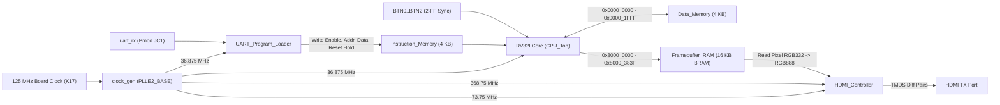

# RV32I Single-Cycle RISC-V SoC with 720p HDMI Output

A bare-metal 32-bit **RISC-V (RV32I)** System-on-Chip written in VHDL for the **Digilent Zybo Z7-10** (`xc7z010clg400-1`). It executes instructions from on-chip memory, accepts live program uploads over UART, reads physical pushbuttons, and drives a real-time **1280x720 DVI/HDMI** display running a bare-metal **Pong** game in C.

The project also includes a full **GHDL + SDL2 hardware simulator** so you can play the game or verify HDMI video timing directly on your PC from the actual VHDL RTL before flashing the FPGA.

> **Think of the architecture like an artist and a gallery display sharing a whiteboard:** the RISC-V CPU (the artist) draws game objects into a small `160x90` pixel memory whenever it updates the game, while the HDMI controller (the display scanner) continuously reads that memory in the background, scales every pixel up 8x, and streams 720p video over TMDS differential pairs to the monitor.

---

## System Specifications

| Feature | Specification |
| :--- | :--- |
| **Target FPGA / Board** | Digilent Zybo Z7-10 (`xc7z010clg400-1`, board part `digilentinc.com:zybo-z7-10:part0:1.2`) |
| **ISA & Microarchitecture** | 32-bit single-cycle **RV32I** (`CPU_Top`) |
| **System Clock Domains** | `125 MHz` board input -> `36.875 MHz` CPU, `73.75 MHz` HDMI Pixel, `368.75 MHz` TMDS Serial |
| **Instruction Memory (`IMEM`)** | 4 KB (1,024 x 32-bit words), initialized from `imem.mem`, UART-writable |
| **Data Memory (`DMEM`)** | 4 KB (1,024 x 32-bit words), supports byte, halfword, and word loads/stores |
| **Video Output** | 720p (`1280x720`) DVI/HDMI over TMDS, hardware 8x upscaled from `160x90` RGB332 VRAM |
| **Video Memory (`VRAM`)** | 16 KB dual-port BRAM (`16384 x 8` bits; `14,400` active bytes used for `160x90`) |
| **Program Loading** | `115200` baud 8N1 UART receiver (`UART_Program_Loader`) on Pmod `JC1` (`V15`) |
| **User I/O** | 3 synchronized game buttons (`BTN0`–`BTN2`), 1 reset (`BTN3`), 4 status LEDs |

---

## High-Level Architecture



### Clock Domains (`clock_gen.vhd`)

All clocks are generated from a single Xilinx `PLLE2_BASE` primitive (`125 MHz` input, `CLK_MULTIPLY = 59`, `CLK_DIVIDE = 5`, `VCO = 1475 MHz`) and buffered with `BUFG`:

| Clock Signal | Divider | Frequency | Consumers |
| :--- | :--- | :--- | :--- |
| `clk_in` | — | `125.000 MHz` | Board oscillator (`K17`) feeding `PLLE2_BASE` |
| `clk_serial` (`CLKOUT0`) | `/ 4` | `368.750 MHz` | `OutputSERDES` (5x pixel clock for 10:1 DDR TMDS serialization) |
| `clk_pixel` (`CLKOUT1`) | `/ 20` | `73.750 MHz` | `timing_generator`, `Framebuffer_RAM` port B, `tmds_encoder` |
| `clk_cpu` (`CLKOUT2`) | `/ 40` | `36.875 MHz` | `CPU_Top`, `UART_Program_Loader`, `Instruction_Memory`, `Data_Memory`, `Framebuffer_RAM` port A |

Because all three generated clocks share the same `1475 MHz` VCO, the `36.875 MHz` CPU clock is exactly half the `73.75 MHz` pixel clock, keeping CPU VRAM writes and video clock boundaries cleanly phase-aligned.

---

## Single-Cycle RV32I CPU Core

Each instruction completes in a single `36.875 MHz` clock cycle inside [CPU_Top.vhd](RISC-V-CPU.srcs/sources_1/new/CPU_Top.vhd):

1. **Fetch**: [PC.vhd](RISC-V-CPU.srcs/sources_1/new/PC.vhd) holds the byte-addressed program counter (clearing bit 0 on write so PC stays halfword-aligned) and feeds [Instruction_Memory.vhd](RISC-V-CPU.srcs/sources_1/new/Instruction_Memory.vhd), which outputs the 32-bit instruction combinationally.
2. **Decode & Register Read**: [Control.vhd](RISC-V-CPU.srcs/sources_1/new/Control.vhd) decodes the 7-bit `opcode`, [Imm_Gen.vhd](RISC-V-CPU.srcs/sources_1/new/Imm_Gen.vhd) unpacks and sign-extends I/S/B/U/J immediates, and [Registers.vhd](RISC-V-CPU.srcs/sources_1/new/Registers.vhd) reads `rs1` and `rs2` (`x0` is hardwired to zero).
3. **Execute & Branch Resolution**: Muxes select ALU input A (`rs1` or `PC` for `AUIPC`) and ALU input B (`rs2` or `imm_out`). [ALU_Control.vhd](RISC-V-CPU.srcs/sources_1/new/ALU_Control.vhd) translates `(alu_op, funct3, funct7(5))` into one of 11 operations in [ALU.vhd](RISC-V-CPU.srcs/sources_1/new/ALU.vhd), while [Branch_And.vhd](RISC-V-CPU.srcs/sources_1/new/Branch_And.vhd) evaluates branch conditions (`BEQ`, `BNE`, `BLT`, `BGE`, `BLTU`, `BGEU`) or unconditional jumps (`JAL`, `JALR`).
4. **Memory / MMIO**: `alu_result` acts as the byte address for loads and stores across `Data_Memory`, `Framebuffer_RAM` (VRAM), or `BUTTONS`.
5. **Writeback**: A 3-way mux chain writes either `PC + 4` (for `JAL`/`JALR`), memory/MMIO read data, or `alu_result` back to `rd` on the rising edge of `cpu_clk`.

### Supported Instructions

Defined in [Constants.vhd](RISC-V-CPU.srcs/sources_1/new/Constants.vhd) and decoded by [Control.vhd](RISC-V-CPU.srcs/sources_1/new/Control.vhd) and [ALU_Control.vhd](RISC-V-CPU.srcs/sources_1/new/ALU_Control.vhd):

- **R-Type ALU**: `ADD`, `SUB`, `SLL`, `SLT`, `SLTU`, `XOR`, `SRL`, `SRA`, `OR`, `AND`
- **I-Type ALU**: `ADDI`, `SLTI`, `SLTIU`, `XORI`, `ORI`, `ANDI`, `SLLI`, `SRLI`, `SRAI`
- **Loads & Stores**: `LB`, `LH`, `LW`, `LBU`, `LHU`, `SB`, `SH`, `SW`
- **Branches & Jumps**: `BEQ`, `BNE`, `BLT`, `BGE`, `BLTU`, `BGEU`, `JAL`, `JALR`
- **Upper Immediates**: `LUI` (`ALU_PASS_B`), `AUIPC` (`PC + imm`)

*(Note: `OP_SYSTEM` (`1110011`) is declared in `Constants.vhd`, while CSR/ECALL trap logic is not implemented—all instructions default to non-faulting execution.)*

### CPU RTL Modules

| File | Role |
| :--- | :--- |
| [CPU_Top.vhd](RISC-V-CPU.srcs/sources_1/new/CPU_Top.vhd) | Top-level SoC: wires RV32I datapath, MMIO decode, reset sync, button sync, UART loader, HDMI, and LEDs |
| [Constants.vhd](RISC-V-CPU.srcs/sources_1/new/Constants.vhd) | Shared opcodes, `funct3` codes, `ALUOP_*` categories, and 4-bit `ALU_*` operations |
| [PC.vhd](RISC-V-CPU.srcs/sources_1/new/PC.vhd) | 32-bit synchronous Program Counter (`0x00000000` on active-high reset) |
| [Instruction_Memory.vhd](RISC-V-CPU.srcs/sources_1/new/Instruction_Memory.vhd) | 1,024-word instruction store initialized from `imem.mem` with UART write port |
| [Control.vhd](RISC-V-CPU.srcs/sources_1/new/Control.vhd) | Combinational main opcode decoder |
| [Registers.vhd](RISC-V-CPU.srcs/sources_1/new/Registers.vhd) | 32 x 32-bit register file (`x0` = 0, async read, sync write) |
| [Imm_Gen.vhd](RISC-V-CPU.srcs/sources_1/new/Imm_Gen.vhd) | Immediate extraction and sign extension for I, S, B, U, and J formats |
| [ALU_Control.vhd](RISC-V-CPU.srcs/sources_1/new/ALU_Control.vhd) | Secondary decoder mapping instruction fields to ALU control codes |
| [ALU.vhd](RISC-V-CPU.srcs/sources_1/new/ALU.vhd) | 32-bit combinational ALU supporting 11 arithmetic/logic/shift/compare ops + `zero` flag |
| [Branch_And.vhd](RISC-V-CPU.srcs/sources_1/new/Branch_And.vhd) | Evaluates branch `funct3` + ALU `zero` flag and `jump` to drive `pc_src` |
| [Data_Memory.vhd](RISC-V-CPU.srcs/sources_1/new/Data_Memory.vhd) | 1,024-word RAM (`init_ram("dmem.mem")`) with sub-word byte/halfword masking and sign extension |
| [Mux2.vhd](RISC-V-CPU.srcs/sources_1/new/Mux2.vhd) | Generic 32-bit 2-to-1 multiplexer |
| [Adder.vhd](RISC-V-CPU.srcs/sources_1/new/Adder.vhd) | 32-bit ripple/unsigned combinational adder (`PC + 4` and branch/jump targets) |

---

## Memory Map & MMIO

Address decoding inside [CPU_Top.vhd](RISC-V-CPU.srcs/sources_1/new/CPU_Top.vhd) uses bit 31 (`alu_result(31)`) to split normal RAM from Memory-Mapped I/O, and bit 16 (`alu_result(16)`) to distinguish `VRAM` from `BUTTONS`:

| Base Address | Range | Size | Target | Notes |
| :--- | :--- | :--- | :--- | :--- |
| `0x00000000` | `0x00000000` – `0x00000FFF` | 4 KB | `Instruction_Memory` | Read by `PC` fetch; written via UART loader |
| `0x00001000` | `0x00001000` – `0x00001FFF` | 4 KB | `Data_Memory` | Stores `.data`, `.bss`, and stack (`_stack_top = 0x00002000`) |
| `0x80000000` | `0x80000000` – `0x8000383F` | 14,400 B (16 KB BRAM) | `Framebuffer_RAM` (`VRAM`) | `160 x 90` RGB332 pixels (`byte_addr = y * 160 + x`) |
| `0x80010000` | `0x80010000` – `0x8001FFFF` | 1 word (read-only) | `BUTTONS` | Bits `[2:0]` = synchronized `[btn(2), btn(1), btn(0)]`; upper bits `0` |

> **Why `Data_Memory` starts at `0x00001000` in software:** [linker.ld](firmware/linker.ld) places `ROM` at `0x00000000` (4 KB) and `RAM` at `0x00001000` (4 KB) so code and data addresses never overlap in C/assembly. In hardware, [Data_Memory.vhd](RISC-V-CPU.srcs/sources_1/new/Data_Memory.vhd) indexes its 1,024-word array with `address(11 downto 2)` and ignores bits above bit 11 whenever `alu_result(31) = '0'`, cleanly mapping `0x00001000`–`0x00001FFF` to its 4 KB RAM.

### Reset & Button Synchronization

- **CPU Reset (`cpu_rst`)**: Asserted whenever external `rst` (`BTN3`), `!pll_locked`, or `loader_active` is high, and released synchronously through a 2-flip-flop synchronizer on `cpu_clk`.
- **Buttons (`btn_sync`)**: External pushbuttons (`btn(2:0)`) pass through a 2-stage flip-flop synchronizer (`btn_meta` -> `btn_sync`) before being exposed at `0x80010000`.

---

## UART Program Loader (Live Reprogramming)

Instead of waiting several minutes for Vivado to re-synthesize a bitstream every time you modify C firmware, [UART_Program_Loader.vhd](RISC-V-CPU.srcs/sources_1/new/UART_Program_Loader.vhd) lets you upload compiled `.mem` programs straight into `Instruction_Memory` over serial at `115200` baud (`CLKS_PER_BIT = 36,875,000 / 115,200 = 320` cycles).

> **Analogy:** Imagine hitting pause on a cassette player, recording the new track over the tape, and hitting play again from the beginning—as soon as the first byte arrives over UART, the loader holds the CPU in reset, streams words into `Instruction_Memory`, and releases reset once the end-of-transmission token arrives.

1. **Activation**: The first received byte sets `loader_active <= '1'`, halting `CPU_Top` in reset.
2. **Word Assembly**: Every 4 bytes received (little-endian: byte 0 -> `[7:0]`, byte 3 -> `[31:24]`) trigger a 32-bit write into `Instruction_Memory` starting at byte address `0x00000000`, incrementing by `4` per word.
3. **End Token & Boot**: Receiving 4 consecutive `0xFF` bytes clears `loader_active <= '0'` and resets `word_addr` back to `0`. `CPU_Top` then boots cleanly from `PC = 0x00000000`. ([tools/load_program.py](tools/load_program.py) transmits 6 `0xFF` bytes to guarantee completion even across unaligned boundaries.)

---

## DVI/HDMI Video Pipeline

The video subsystem in [HDMI_Controller.vhd](RISC-V-CPU.srcs/sources_1/new/HDMI_Controller.vhd) outputs a standard **1280x720 (720p @ ~59.7 Hz)** signal using **14.4 KB of BRAM**:

1. **Timing Generation ([timing_generator.vhd](RISC-V-CPU.srcs/sources_1/new/timing_generator.vhd))**:
   - **Horizontal**: `1280` active, `72` front porch, `80` sync, `216` back porch (`1648` total clocks/line).
   - **Vertical**: `720` active, `3` front porch, `5` sync, `22` back porch (`750` total lines/frame).
   - Both `hsync` and `vsync` are **active-high**.
2. **8x Hardware Upscaling & RGB332 Framebuffer ([Framebuffer_RAM.vhd](RISC-V-CPU.srcs/sources_1/new/Framebuffer_RAM.vhd))**:
   - Dropping the lowest 3 bits of screen coordinates (`pixel_x(10 downto 3)` and `pixel_y(9 downto 3)`) scales `160x90` up by 8x into `1280x720` with zero extra logic cost.
   - Each byte in VRAM encodes **RGB332** (`[7:5]` = Red, `[4:2]` = Green, `[1:0]` = Blue), expanded to 24-bit RGB888 by bit replication:
     - `R[7:0] = r3 & r3 & r3(2 downto 1)`
     - `G[7:0] = g3 & g3 & g3(2 downto 1)`
     - `B[7:0] = b2 & b2 & b2 & b2`
   - A 3-stage read pipeline (`address -> BRAM read -> DOB_REG`) matches the 3-cycle pipeline delay (`hsync_pipe`, `vsync_pipe`, `de_pipe`) on the timing signals.
3. **TMDS Encoding & Serialization**:
   - [HDMI_Controller.vhd](RISC-V-CPU.srcs/sources_1/new/HDMI_Controller.vhd) swaps RGB channels into Digilent `rgb2dvi`'s expected `(23:16)=R`, `(15:8)=B`, `(7:0)=G` wire order (`vid_pData <= rgb_r & rgb_b & rgb_g`).
   - Digilent's [rgb2dvi.vhd](RISC-V-CPU.srcs/sources_1/new/rgb2dvi.vhd), [tmds_encoder.vhd](RISC-V-CPU.srcs/sources_1/new/tmds_encoder.vhd), and [OutputSERDES.vhd](RISC-V-CPU.srcs/sources_1/new/OutputSERDES.vhd) (`OSERDESE2` + `OBUFDS`) encode 8-bit color + sync into DC-balanced 10-bit TMDS symbols serialized at `368.75 MHz` DDR.
   - *(Note: [ClockGen.vhd](RISC-V-CPU.srcs/sources_1/new/ClockGen.vhd) remains in `sources_1/new/` because `rgb2dvi.vhd` statically references `entity work.ClockGen` inside its `kGenerateSerialClk` generate branch, even though `HDMI_Controller` sets `kGenerateSerialClk => false`.)*

### Video RTL Modules

| File | Role |
| :--- | :--- |
| [clock_gen.vhd](RISC-V-CPU.srcs/sources_1/new/clock_gen.vhd) | `PLLE2_BASE` generating `368.75 MHz`, `73.75 MHz`, and `36.875 MHz` |
| [HDMI_Controller.vhd](RISC-V-CPU.srcs/sources_1/new/HDMI_Controller.vhd) | Connects `clock_gen`, `timing_generator`, `Framebuffer_RAM`, and `rgb2dvi` |
| [timing_generator.vhd](RISC-V-CPU.srcs/sources_1/new/timing_generator.vhd) | Generates 720p pixel coordinates, `hsync`, `vsync`, and `video_active` |
| [Framebuffer_RAM.vhd](RISC-V-CPU.srcs/sources_1/new/Framebuffer_RAM.vhd) | Dual-port 16 KB BRAM with 8x spatial scaling and RGB332 -> RGB888 conversion |
| [rgb2dvi.vhd](RISC-V-CPU.srcs/sources_1/new/rgb2dvi.vhd) | Digilent DVI-to-TMDS top wrapper |
| [tmds_encoder.vhd](RISC-V-CPU.srcs/sources_1/new/tmds_encoder.vhd) | DVI 1.0 8b/10b TMDS encoder |
| [OutputSERDES.vhd](RISC-V-CPU.srcs/sources_1/new/OutputSERDES.vhd) | Xilinx 7-series `OSERDESE2` + `OBUFDS` differential output serializer |
| [DVI_Constants.vhd](RISC-V-CPU.srcs/sources_1/new/DVI_Constants.vhd), [ClockGen.vhd](RISC-V-CPU.srcs/sources_1/new/ClockGen.vhd), [SyncAsync.vhd](RISC-V-CPU.srcs/sources_1/new/SyncAsync.vhd), [SyncAsyncReset.vhd](RISC-V-CPU.srcs/sources_1/new/SyncAsyncReset.vhd) | Digilent `rgb2dvi` support packages and clock/reset synchronizers |

---

## Zybo Z7-10 Pinout & Status LEDs

Constraints are defined in [zybo_z7.xdc](RISC-V-CPU.srcs/constrs_1/new/zybo_z7.xdc):

| Port | FPGA Pin(s) | I/O Standard | Function |
| :--- | :--- | :--- | :--- |
| `clk` | `K17` | `LVCMOS33` | `125 MHz` system clock |
| `rst` | `Y16` (`BTN3`) | `LVCMOS33` | Active-high manual reset |
| `btn[0]` | `K18` (`BTN0`) | `LVCMOS33` | Paddle **UP** (read via `0x80010000` bit 0) |
| `btn[1]` | `P16` (`BTN1`) | `LVCMOS33` | Paddle **DOWN** (read via `0x80010000` bit 1) |
| `btn[2]` | `K19` (`BTN2`) | `LVCMOS33` | **Restart / Reset** game state (read via `0x80010000` bit 2) |
| `uart_rx` | `V15` (`Pmod JC1`) | `LVCMOS33` (`PULLUP`) | `115200` baud UART RX input (`UART_Program_Loader`) |
| `led[0]` | `M14` (`LD0`) | `LVCMOS33` | `pll_locked` — solid ON when clocks are stable |
| `led[1]` | `M15` (`LD1`) | `LVCMOS33` | `heartbeat_cnt(24)` — blinks at `~1.1 Hz` (`36.875 MHz / 2^25`) |
| `led[2]` | `G14` (`LD2`) | `LVCMOS33` | `vram_we` — flashes when the CPU writes pixels to VRAM |
| `led[3]` | `D18` (`LD3`) | `LVCMOS33` | Any user button (`BTN0`, `BTN1`, or `BTN2`) currently pressed |
| `hdmi_clk_p/n` | `H16 / H17` | `TMDS_33` | HDMI TX TMDS clock differential pair |
| `hdmi_data_p/n[0..2]` | `D19/D20`, `C20/B20`, `B19/A20` | `TMDS_33` | HDMI TX TMDS data differential pairs (Blue, Green, Red) |

---

## Bare-Metal Pong Firmware (`firmware/`)

The on-chip software is a zero-OS, freestanding C program compiled for RV32I (`-march=rv32i -mabi=ilp32 -O2`):

- **[crt0.s](firmware/crt0.s)**: Initializes stack pointer `sp` to `_stack_top` (`0x00002000`) and calls `main()`.
- **[linker.ld](firmware/linker.ld)**: Splits memory cleanly into `ROM` (`0x00000000`, 4 KB) for `.text` and `RAM` (`0x00001000`, 4 KB) for `.rodata`, `.data`, `.bss`, and stack.
- **[main.c](firmware/main.c)**:
  - Clears the `160x90` VRAM to black (`0x00`) and draws a dashed center net (`0x49`, dark gray).
  - Runs an infinite loop updating the left AI paddle (`COLOR_GREEN = 0x1C`), right player paddle (`COLOR_RED = 0xE0`), and white ball/score pips (`COLOR_WHITE = 0xFF`) using partial rectangle erase/redraw to avoid full-screen flicker.
  - Controls frame pacing using `#ifdef SIM_FAST` -> `delay(1200)` for GHDL simulation, and `delay(615000)` on FPGA hardware (~33.4 ms per frame / **~30 FPS** at `36.875 MHz`, since GCC `-O2` compiles `while (count > 0) count--;` on `volatile int count` to 2 cycles per iteration).
- **[build.bat](firmware/build.bat) & [make_hex.py](firmware/make_hex.py)**: Compiles with Vitis `riscv64-unknown-elf-gcc`, extracts `firmware.bin` via `objcopy`, converts bytes into 32-bit little-endian hex words (`495` words currently), and automatically copies the resulting `imem.mem` to:
  1. [firmware/imem.mem](firmware/imem.mem)
  2. [imem.mem](imem.mem)
  3. [RISC-V-CPU.srcs/sources_1/new/imem.mem](RISC-V-CPU.srcs/sources_1/new/imem.mem)

---

## Simulation & Verification Tools

### 1. GHDL + SDL2 Interactive HDMI Simulator (`tools/hdmi_sim/`)

[run_hdmi_sim.py](tools/hdmi_sim/run_hdmi_sim.py) compiles the real VHDL design with **GHDL-LLVM** and links it via VHPIDIRECT against a C/SDL2 monitor ([hdmi_monitor.c](tools/hdmi_sim/hdmi_monitor.c)) that renders scanlines into a live desktop window or saves a 24-bit `.bmp` screenshot after verifying `hsync`, `vsync`, and `vde` timings.

| Target / Flag | Purpose |
| :--- | :--- |
| `hdmi` | Tests `HDMI_Controller` alone in SMPTE color-bar pattern mode |
| `cpu` | Tests full `CPU_Top` SoC executing `imem.mem` through `VRAM` -> `HDMI_Controller` |
| `--mode verify` | Headless run checking resolution/blanking timings and writing `--out <file.bmp>` |
| `--mode live` | Opens an interactive SDL2 window with progressive scanline updates and keyboard input |
| `--native-res` | Switches simulated timing to `160x90` (skipping 8x pixel upscaling -> ~64x fewer pixels/frame) |
| `--fast-rgb` | Reads parallel 24-bit RGB + sync from `Framebuffer_RAM` directly at pixel rate (bypasses 5x serial TMDS oversampling) |
| `--fast-fw` | Compiles `main.c` with `-DSIM_FAST` (`delay(1200)`) into `tools/hdmi_sim/sim_fw/` without modifying board `imem.mem` |
| `--fast` | Recommended preset enabling `--native-res`, `--fast-rgb`, and `--fast-fw` together for playable live simulation |
| `--no-build` | Skips GHDL re-analysis/elaboration when reusing an existing build directory |

**Live Mode Keyboard Controls** (latched across 2 frames on key press in `hdmi_monitor.c` so taps are reliably sampled):
- `W` or `Up Arrow` -> `BTN0` (Paddle Up)
- `S` or `Down Arrow` -> `BTN1` (Paddle Down)
- `R` or `Space` -> `BTN2` (Reset Game)
- `Esc` -> Quit simulator

### 2. Vivado XSim Unit Testbenches (`RISC-V-CPU.srcs/sim_1/new/`)

Modular VHDL testbenches configured in [RISC-V-CPU.xpr](RISC-V-CPU.xpr):
`tb_Constants`, `tb_Control`, `tb_ALU_Control`, `tb_ALU`, `tb_Imm_Gen`, `tb_Registers`, `tb_PC`, `tb_Instruction_Memory`, `tb_Data_Memory`, `tb_HDMI_Controller`, `tb_CPU_Top`.

### 3. Utility Scripts (`tools/`)

- **[load_program.py](tools/load_program.py)**: Serial uploader for `UART_Program_Loader` (`--port`, `--baud`, `--delay`, `--list`).
- **[test_c_game.py](tools/test_c_game.py)**: Lightweight Python RV32I instruction-set simulator for quick offline inspection of firmware memory/VRAM execution.
- **[ppm_to_bmp.py](tools/ppm_to_bmp.py)**: Converts `.ppm` frame dumps into standard 24-bit Windows `.bmp` images.

---

## Quick-Start Workflows

### Run Playable Live Pong Simulation on PC

Requires MSYS2 UCRT64 (`ghdl`, `gcc`, `SDL2`, Python) and Vitis RISC-V GCC (for `--fast-fw`):

```powershell
C:\msys64\ucrt64\bin\python.exe -B tools/hdmi_sim/run_hdmi_sim.py cpu --mode live --fast
```

Or run a quick headless timing & frame smoke test (saves BMP + prints timing report):

```powershell
C:\msys64\ucrt64\bin\python.exe -B tools/hdmi_sim/run_hdmi_sim.py cpu --mode verify --fast --frames 6 --out pong_smoke.bmp
```

### Rebuild Pong C Firmware

Compiles [firmware/main.c](firmware/main.c) and updates all three `imem.mem` copies across the repository:

```cmd
cd firmware
build.bat
```

### Run on Zybo Z7-10 FPGA

1. Open [RISC-V-CPU.xpr](RISC-V-CPU.xpr) in Vivado (`CPU_Top` top module), run **Synthesis -> Implementation -> Generate Bitstream**, and program the Zybo Z7-10 over JTAG.
2. Confirm `LD0` (`pll_locked`) is solid ON and `LD1` (`heartbeat`) blinks steadily.
3. Connect an HDMI cable from the Zybo **HDMI TX** port to a monitor (`1280x720`).
4. Play Pong using `BTN0` (Up), `BTN1` (Down), `BTN2` (Restart game), and `BTN3` (CPU Reset).

### Upload New Firmware via UART (Without Re-Synthesizing Bitstream)

Connect a USB-UART adapter TX pin to Zybo **Pmod JC1** (`V15`, plus shared `GND`), check available COM ports, and stream `imem.mem`:

```powershell
python tools/load_program.py --list
python tools/load_program.py --port COM3
```

---

## Repository Structure

```text
RISC-V-CPU/
├── RISC-V-CPU.xpr                 # Vivado project file (Zybo Z7-10, top = CPU_Top)
├── imem.mem / dmem.mem            # Root-synced instruction and data memory hex images
├── RISC-V-CPU.srcs/
│   ├── sources_1/new/             # Synthesizable VHDL RTL (RV32I core, UART, HDMI, Digilent TMDS) + imem.mem / dmem.mem
│   ├── constrs_1/new/zybo_z7.xdc  # Pinout & I/O standard constraints for Zybo Z7-10
│   └── sim_1/new/                 # 11 Vivado VHDL unit & system testbenches
├── firmware/
│   ├── crt0.s                     # Bare-metal startup (_start -> sp init -> main)
│   ├── linker.ld                  # Memory layout (4 KB ROM @ 0x0, 4 KB RAM @ 0x1000)
│   ├── main.c                     # Bare-metal Pong game + SIM_FAST support
│   ├── build.bat                  # Vitis riscv64-unknown-elf-gcc build script
│   ├── make_hex.py                # Binary-to-.mem converter syncing all 3 repo copies
│   └── imem.mem                   # Compiled firmware hex output
├── tools/
│   ├── load_program.py            # UART program uploader for UART_Program_Loader
│   ├── test_c_game.py             # Python RV32I functional simulator
│   ├── ppm_to_bmp.py              # PPM-to-BMP image converter
│   └── hdmi_sim/                  # GHDL-LLVM + SDL2 live/headless DVI-HDMI simulator
└── Documentation/                 # Local project notes & Obsidian vault (gitignored)
```
